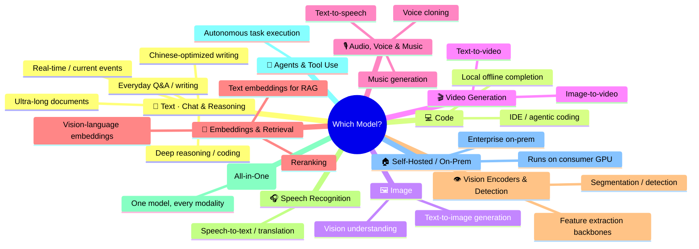
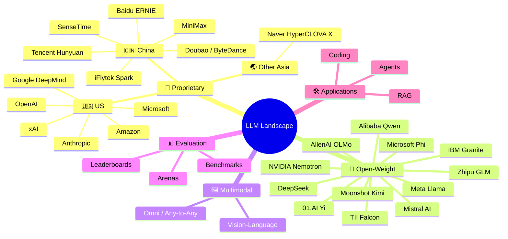
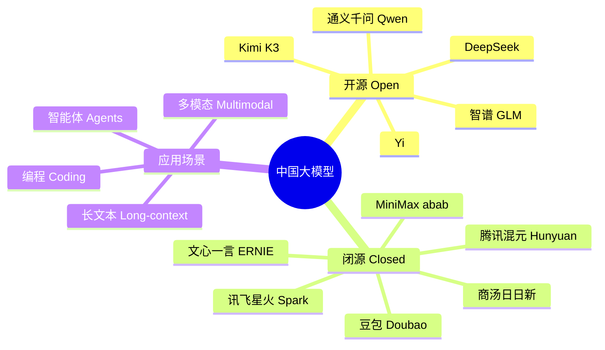

# 🧠 Awesome LLM Landscape

  <b>English</b> ・ <a href="README.zh-CN.md">简体中文</a>

  
  
  
  

  <b>Start from what you're trying to do — chat, code, generate an image, make a video, clone a voice — and land directly on the model(s) people actually use for it.</b>

  🌐 <a href="https://hoobenwang.github.io/awesome-llm-landscape/"><b>Live interactive mind map (GitHub Pages)</b></a>

Most "awesome LLM" lists are organized by *who made the model*. That's useful once you already know what you want — but it doesn't answer the question most people actually have: **"I need to do X, which model should I use?"** This repo leads with a **task-first mind map** for exactly that, then gives you a full **by-organization** directory (with logos, for fast visual recognition) for when you want the complete picture.

> Inspired by [uhub/awesome-llm](https://github.com/uhub/awesome-llm), [hannibal046/Awesome-LLM](https://github.com/hannibal046/Awesome-LLM), [Shubhamsaboo/awesome-llm-apps](https://github.com/Shubhamsaboo/awesome-llm-apps), and [Awesome-LLM-Evaluation](https://alopatenko.github.io/LLMEvaluation/).

## Contents

- [🎯 Quick Picker — What Are You Trying to Do?](#-quick-picker--what-are-you-trying-to-do)
  - [💬 Text: Chat & Reasoning](#-text-chat--reasoning)
  - [💻 Code](#-code)
  - [🖼️ Image](#️-image)
  - [🎬 Video Generation](#-video-generation)
  - [🎙️ Audio, Voice & Music](#️-audio-voice--music)
  - [🔎 Embeddings, Retrieval & Reranking](#-embeddings-retrieval--reranking)
  - [👁️ Vision Encoders & Detection](#️-vision-encoders--detection)
  - [🎧 Speech Recognition & Translation](#-speech-recognition--translation)
  - [🧩 Omni (All-in-One Multimodal)](#-omni-all-in-one-multimodal)
  - [🤖 Agents & Tool Use](#-agents--tool-use)
  - [🏠 Self-Hosted / On-Prem](#-self-hosted--on-prem)
- [📚 Full Directory by Organization](#-full-directory-by-organization)
- [📊 Evaluation & Benchmarks](#-evaluation--benchmarks)
- [🛠️ Build With LLMs](#️-build-with-llms)
- [🔗 Related Awesome Lists](#-related-awesome-lists)
- [🤝 Contributing](#-contributing)

---

## 🎯 Quick Picker — What Are You Trying to Do?

> If the diagram above renders as plain text instead of a graphic, open this file on [mermaid.live](https://mermaid.live) or in VS Code — GitHub's mermaid renderer occasionally lags.

Note: a few rows below (image/video/audio generation) aren't *language* models in the strict sense — they're diffusion or audio models — but they're part of the same "which model do I reach for" decision, so they're included here for completeness.

### 💬 Text: Chat & Reasoning

| Scenario | Recommended | Why |
|---|---|---|
| Everyday Q&A / writing | GPT-5, Claude 5 Sonnet, Gemini, Doubao, Qwen | Best balance of quality, speed, and cost for daily use |
| Deep reasoning / coding agents | Claude 5 Opus, GPT-5 (o-series), DeepSeek-R1, Qwen3-Max | Strongest step-by-step reasoning and long-horizon planning |
| Ultra-long documents/codebases (200K–1M+ tokens) | Gemini, DeepSeek, Qwen, Kimi K3 | Native long-context windows without heavy quality drop-off |
| Chinese writing & creative tasks | ERNIE, Qwen, Doubao | Tuned specifically for Chinese nuance and style |
| Privacy / self-host / offline | Llama 4, Qwen (open), DeepSeek-V3, GLM, Mistral | Download the weights, run on your own hardware |
| Real-time info / current events | Grok (xAI) | Direct, low-latency access to live X/Twitter data |

### 💻 Code

| Scenario | Recommended | Why |
|---|---|---|
| IDE copilot / agentic coding (plans, edits, runs tests) | Claude 5 (Sonnet/Opus), GPT-5 | Top scores on SWE-bench-style real-world issue resolution |
| Local/offline code completion | Qwen-Coder, DeepSeek-Coder, Phi | Small enough to run on a laptop or single GPU |

### 🖼️ Image

| Scenario | Recommended | Why |
|---|---|---|
| Understand/describe an image (vision) | GPT-5 (vision), Gemini, Claude 5, Qwen-VL, InternVL | Read screenshots, charts, documents, photos |
| Generate an image from text | Midjourney, GPT Image (OpenAI), Imagen (Google), FLUX (Black Forest Labs), Stable Diffusion, 即梦/Doubao (ByteDance) | Range from photoreal to fast/cheap iteration |

### 🎬 Video Generation

| Scenario | Recommended | Why |
|---|---|---|
| Text-to-video | Sora 2 (OpenAI), Veo (Google DeepMind), Kling 可灵 (Kuaishou), 海螺 Hailuo (MiniMax), Luma Dream Machine | Current frontier for realism and shot length |
| Image-to-video / animation | Kling, Hailuo, Runway Gen-4, Luma | Animate a still image into a short clip |

### 🎙️ Audio, Voice & Music

| Scenario | Recommended | Why |
|---|---|---|
| Text-to-speech | OpenAI audio, ElevenLabs, MiniMax voice | Natural prosody, many languages/accents |
| Voice cloning | ElevenLabs, MiniMax, CosyVoice (Alibaba) | Few seconds of reference audio to clone a voice |
| Music generation | Suno, Udio | Full songs (vocals + instrumental) from a text prompt |

### 🔎 Embeddings, Retrieval & Reranking

The models underneath every RAG / search / "find similar" pipeline — they turn text or images into vectors instead of generating text.

| Scenario | Recommended | Why |
|---|---|---|
| Text embeddings for RAG/search | OpenAI text-embedding-3, Cohere Embed, BGE (BAAI), Qwen-Embedding, Voyage AI, Jina Embeddings | Map text to vectors for semantic search and retrieval |
| Fully open (data + code + weights), long context | Nomic Embed | 8K-token context, Apache 2.0, fully reproducible training recipe |
| Top MTEB multilingual ranking | GTE (Alibaba), E5 (Microsoft), Snowflake Arctic Embed | Strong general-purpose retrieval accuracy; Apache 2.0 / MIT |
| Efficient / quantizable at scale | mxbai-embed (Mixedbread AI) | Matryoshka + binary quantization — much cheaper vector storage at near-equal accuracy |
| Chasing best raw MTEB score, research only | NV-Embed (NVIDIA) | Was #1 on MTEB — but **non-commercial license only** (CC-BY-NC-4.0), not for production use |
| Vision-language embeddings | SigLIP / SigLIP2 (Google), CLIP (OpenAI) | Map images and text into the same embedding space — zero-shot classification, image search |
| Reranking retrieved results | Cohere Rerank, BGE-reranker (BAAI), Jina Reranker | Re-score a candidate list for much better top-k precision than embeddings alone |

> These are usually deployed via `sentence-transformers`, `transformers`, or exported to **ONNX** and served with ONNX Runtime for fast CPU/edge inference. ONNX itself is a model *format/runtime* — not a model — so you won't see it as a row here, but you'll see it a lot in the deployment docs for the models above (and for the small open-weight chat models in [Self-Hosted](#-self-hosted--on-prem) below).

### 👁️ Vision Encoders & Detection

Not chat models or image generators — these are the vision *building blocks* other pipelines are built on: general-purpose feature extraction, segmentation, and object detection. Several have real licensing gotchas worth knowing before you build on them.

| Model | Organization | Known For | License / Note | Link |
|---|---|---|---|---|
| DINOv2 / DINOv3 | Meta AI | Self-supervised vision backbone — no labels needed, strong general-purpose visual features | DINOv2: Apache 2.0 · **DINOv3: custom license**, requires "Built with DINOv3" attribution + access approval | [ai.meta.com/research/dinov3](https://ai.meta.com/research/dinov3/) |
| I-JEPA / V-JEPA2 | Meta AI (FAIR) | Predicts representations instead of pixels (JEPA architecture) — efficient self-supervised learning for images (I-JEPA) and video (V-JEPA2) | Research license — verify before commercial use | [ai.meta.com/blog/yann-lecun-ai-model-i-jepa](https://ai.meta.com/blog/yann-lecun-ai-model-i-jepa/) |
| AIMv2 | Apple | Autoregressive multimodal vision encoder — outperforms CLIP/SigLIP on multimodal image-understanding benchmarks | Apple research/sample-code terms (not standard OSS — verify before commercial use) | [github.com/apple/ml-aim](https://github.com/apple/ml-aim) |
| EVA-CLIP | BAAI | Scaled-up CLIP training recipe — EVA-CLIP-18B is the largest open CLIP model | MIT | [github.com/baaivision/EVA](https://github.com/baaivision/EVA) |
| Segment Anything (SAM2 / SAM3) | Meta AI | Promptable image/video segmentation — SAM3 adds text/concept-based segmentation | SAM2: Apache 2.0 · **SAM3: gated "SAM License"** (more restrictive, requires HF access approval) | [ai.meta.com/research/sam3](https://ai.meta.com/research/sam3/) |
| Grounding DINO | IDEA Research | Open-vocabulary object detection — detect objects from a text description instead of a fixed label set | Apache 2.0 | [github.com/IDEA-Research/GroundingDINO](https://github.com/IDEA-Research/GroundingDINO) |
| YOLO26 | Ultralytics | Current flagship real-time object detector — NMS-free, fast even on CPU | **AGPL-3.0** (copyleft) for open-source use; commercial license required for closed-source products | [docs.ultralytics.com/models/yolo26](https://docs.ultralytics.com/models/yolo26) |

### 🎧 Speech Recognition & Translation

The counterpart to the text-to-speech models above — turning speech *into* text (or into another language).

| Model | Organization | Known For | License / Note | Link |
|---|---|---|---|---|
| Whisper | OpenAI | General-purpose multilingual ASR + translation + language ID | MIT | [github.com/openai/whisper](https://github.com/openai/whisper) |
| SeamlessM4T | Meta AI | One model for ASR + speech/text translation across ~100 languages | Research / non-commercial — verify exact terms before commercial use | [ai.meta.com/resources/models-and-libraries/seamless-communication-models](https://ai.meta.com/resources/models-and-libraries/seamless-communication-models/) |
| Paraformer / FunASR | Alibaba DAMO Academy | Chinese-first ASR toolkit — also does VAD, punctuation, speaker ID | MIT | [github.com/modelscope/FunASR](https://github.com/modelscope/FunASR) |
| Qwen-Audio / Qwen3-Omni | Alibaba | Understands speech, music & sound; Qwen3-Omni natively handles speech in 19 languages in, 10 out | Apache 2.0 (varies by checkpoint) | [qwen.ai](https://qwen.ai) |
| NVIDIA Canary / Parakeet | NVIDIA | Multilingual ASR + translation (Canary, 25 langs) and fast streaming ASR (Parakeet) | Typically CC-BY-4.0 — confirm per checkpoint | [huggingface.co/nvidia](https://huggingface.co/nvidia) |

> **Also famous, if you're curious:** [AlphaFold](https://deepmind.google/science/alphafold/) (Google DeepMind) is arguably the most famous "foundation model" in all of AI outside language/vision/speech — it predicts 3D protein structure from an amino-acid sequence, and its creators won a Nobel Prize in Chemistry for it in 2024. AlphaFold 2's code is Apache 2.0, but AlphaFold 3's model weights are only available non-commercially via the AlphaFold Server.

### 🧩 Omni (All-in-One Multimodal)

| Scenario | Recommended | Why |
|---|---|---|
| One model for text + image + audio + video in/out | GPT-5, Gemini, Qwen-Omni | Avoids stitching together separate specialized models |

### 🤖 Agents & Tool Use

| Scenario | Recommended | Why |
|---|---|---|
| Autonomous multi-step tasks, computer/tool use | Claude 5 (agent/computer-use), GLM, Kimi K3, GPT-5 (function calling) | Strongest benchmarks for planning + tool invocation over many steps |

### 🏠 Self-Hosted / On-Prem

| Scenario | Recommended | Why |
|---|---|---|
| Runs on a consumer GPU / laptop | Phi, Gemma, small Qwen, small Llama | 1B–8B range, quantizes down to run locally |
| Enterprise on-prem deployment | Llama 4, Qwen (open), DeepSeek-V3, GLM, Granite (IBM), Falcon (TII) | Apache-2.0-style licenses, enterprise support options |

---

## 📚 Full Directory by Organization

Prefer browsing by company instead? Here's the same landscape organized the traditional way.

### 🏢 Proprietary (Closed-Weight) Models

Flagship models you access only through an API or app — weights are not released.

| | Organization | Model Family | Known For | Link |
|---|---|---|---|---|
|  | **OpenAI** 🇺🇸 | GPT-5 series, o-series reasoning | General intelligence, coding, the ChatGPT ecosystem | [openai.com](https://openai.com) |
|  | **Anthropic** 🇺🇸 | Claude 5 (Opus / Sonnet / Haiku) | Long-context reasoning, coding agents, safety-focused alignment | [anthropic.com](https://anthropic.com) |
|  | **Google DeepMind** 🇺🇸 | Gemini series | Native multimodality, 1M+ token context, deep Google ecosystem integration | [deepmind.google](https://deepmind.google) |
|  | **xAI** 🇺🇸 | Grok series | Real-time X/Twitter data access, fast iteration cadence | [x.ai](https://x.ai) |
|  | **Amazon** 🇺🇸 | Nova series | Low-cost, high-throughput models tied to AWS Bedrock | [aws.amazon.com/bedrock](https://aws.amazon.com/bedrock) |
|  | **Microsoft** 🇺🇸 | Copilot (Orchestrated OpenAI + in-house) | Enterprise/Office integration | [microsoft.com/ai](https://www.microsoft.com/ai) |
|  | **Cohere** 🇨🇦 | Command R series | Enterprise RAG & retrieval-tuned models | [cohere.com](https://cohere.com) |
|  | **Baidu** 🇨🇳 | ERNIE series | Chinese-language search & knowledge grounding | [yiyan.baidu.com](https://yiyan.baidu.com) |
|  | **ByteDance** 🇨🇳 | Doubao | Consumer apps, TikTok/Douyin ecosystem | [doubao.com](https://www.doubao.com) |
|  | **Tencent** 🇨🇳 | Hunyuan (混元) series | WeChat/gaming/cloud ecosystem integration | [hunyuan.tencent.com](https://hunyuan.tencent.com) |
|  | **SenseTime** 🇨🇳 | SenseChat (日日新) | Vision-heritage lab, strong multimodal perception + LLM | [sensetime.com](https://www.sensetime.com) |
|  | **iFlytek** 🇨🇳 | Spark (讯飞星火) | Speech + language, education & government sectors | [xfyun.cn](https://www.xfyun.cn) |
|  | **MiniMax** 🇨🇳 | abab series | Long-context chat, multimodal agents | [minimax.io](https://www.minimax.io) |
|  | **Naver** 🇰🇷 | HyperCLOVA X | Korean-language flagship, regional alternative to US/China giants | [clova.ai](https://clova.ai) |

### 🧩 Open-Weight Models

Weights you can download, fine-tune, and self-host.

| | Organization | Model Family | Known For | License Note | Link |
|---|---|---|---|---|---|
|  | **Meta** 🇺🇸 | Llama 4 (Scout / Maverick / Behemoth) | The reference open-weight baseline, huge ecosystem/tooling | Custom community license | [llama.com](https://www.llama.com) |
|  | **Mistral AI** 🇫🇷 | Mistral Large / Small, Mixtral | Efficient MoE architectures, strong multilingual (EU) performance | Apache 2.0 (most variants) | [mistral.ai](https://mistral.ai) |
|  | **DeepSeek** 🇨🇳 | DeepSeek-V3 / R1 | Frontier-level reasoning at a fraction of training/inference cost | MIT / open weights | [deepseek.com](https://www.deepseek.com) |
|  | **Alibaba** 🇨🇳 | Qwen series | Broad size range (0.5B–235B+), strong coding & multilingual | Apache 2.0 (most sizes) | [qwen.ai](https://qwen.ai) |
|  | **Zhipu AI (rebranded "Z.ai")** 🇨🇳 | GLM series | Agentic tool-use, bilingual EN/ZH training focus; dev/API platform is [bigmodel.cn](https://bigmodel.cn) | Apache 2.0 (most variants) | [zhipuai.cn](https://www.zhipuai.cn) |
|  | **Moonshot AI** 🇨🇳 | Kimi (K3, successor to K2) | Ultra-long context, agentic/tool-use benchmarks | Modified MIT | [moonshot.ai](https://www.moonshot.ai) |
|  | **01.AI** 🇨🇳 | Yi series | Bilingual efficiency-focused models | Apache 2.0 | [01.ai](https://www.01.ai) |
|  | **Microsoft** 🇺🇸 | Phi series | Small, high-quality "data-optimal" models for edge/on-device | MIT | [azure.microsoft.com/phi](https://azure.microsoft.com/en-us/products/phi) |
|  | **Google** 🇺🇸 | Gemma series | Lightweight open models derived from Gemini research | Gemma license | [ai.google.dev/gemma](https://ai.google.dev/gemma) |
|  | **NVIDIA** 🇺🇸 | Nemotron series | Distilled/optimized for NVIDIA GPU inference, strong post-training tooling | NVIDIA Open Model License | [nvidia.com/nemotron](https://www.nvidia.com/en-us/ai/nemotron/) |
|  | **IBM** 🇺🇸 | Granite series | Enterprise-focused, documented training-data provenance | Apache 2.0 | [ibm.com/granite](https://www.ibm.com/granite) |
|  | **TII** 🇦🇪 | Falcon series | Leading open model from the Middle East, strong Arabic + multilingual support | Apache 2.0 (Falcon 2+) | [falconllm.tii.ae](https://falconllm.tii.ae) |
|  | **Allen Institute for AI** 🇺🇸 | OLMo series | "Fully open" — training data, code, and weights all released | Apache 2.0 | [allenai.org/olmo](https://allenai.org/olmo) |

### 🇨🇳 Chinese LLM Ecosystem

A closer look at the fast-moving Chinese market, since it spans both tables above.

| Strength | Recommended Model(s) |
|---|---|
| Ultra-long context (1M+ tokens) | DeepSeek, Qwen |
| Long context (200K+ tokens) | Kimi K3 |
| Lowest-cost open weights | DeepSeek-V3 |
| Consumer/C-end products | Doubao |
| Chinese writing & creative tasks | ERNIE, Qwen |
| Agentic tool-use | GLM, Kimi |

## 📊 Evaluation & Benchmarks

Picking a model means knowing how it's measured. Start here:

- **[Awesome LLM Evaluation](https://alopatenko.github.io/LLMEvaluation/)** — the most comprehensive single reference for evaluation methodology, benchmarks, and papers.
- **[LMArena (formerly Chatbot Arena)](https://lmarena.ai/)** — crowdsourced human head-to-head preference ranking.
- **MMLU / MMLU-Pro** — broad academic knowledge benchmark.
- **GPQA Diamond** — graduate-level reasoning questions.
- **SWE-bench** — real-world GitHub issue resolution for coding agents.
- **LiveCodeBench** — contamination-resistant, continuously-refreshed coding benchmark.

## 🛠️ Build With LLMs

Want to *use* these models instead of just reading about them? See **[Shubhamsaboo/awesome-llm-apps](https://github.com/Shubhamsaboo/awesome-llm-apps)** for 50+ real, runnable projects: RAG pipelines, autonomous agents, MCP servers, voice agents, and more.

## 🔗 Related Awesome Lists

- [uhub/awesome-llm](https://github.com/uhub/awesome-llm)
- [hannibal046/Awesome-LLM](https://github.com/hannibal046/Awesome-LLM)
- [Shubhamsaboo/awesome-llm-apps](https://github.com/Shubhamsaboo/awesome-llm-apps)
- [Awesome-LLM-Evaluation](https://alopatenko.github.io/LLMEvaluation/)

## 🤝 Contributing

New model, wrong logo, outdated version number, or a scenario we haven't covered? PRs are very welcome — see [CONTRIBUTING.md](CONTRIBUTING.md). This landscape moves fast; this list is only useful if it stays current.

## License

[MIT](LICENSE)
