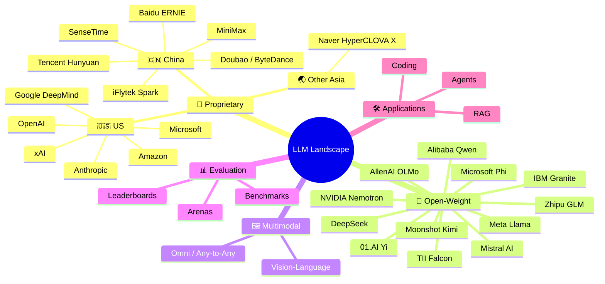
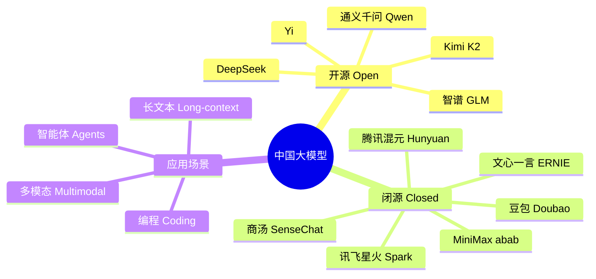

# 🧠 Awesome LLM Landscape

  <b>English</b> ・ <a href="README.zh-CN.md">简体中文</a>

  
  
  
  

A mind-map style, logo-illustrated guide to today's mainstream Large Language Models — who makes them, what they're good at, and how they relate to each other.

  🌐 <a href="https://hoobenwang.github.io/awesome-llm-landscape/"><b>Live interactive mind map (GitHub Pages)</b></a>

Most "awesome LLM" lists are long, flat bullet dumps. This one is organized as a **mind map** first, so you can see the shape of the landscape at a glance, then drill into tables with **logos** for fast visual recognition, plus links to benchmarks and real-world applications.

> Inspired by [uhub/awesome-llm](https://github.com/uhub/awesome-llm), [hannibal046/Awesome-LLM](https://github.com/hannibal046/Awesome-LLM), [Shubhamsaboo/awesome-llm-apps](https://github.com/Shubhamsaboo/awesome-llm-apps), and [Awesome-LLM-Evaluation](https://alopatenko.github.io/LLMEvaluation/).

## Contents

- [🗺️ Mind Map Overview](#️-mind-map-overview)
- [🏢 Proprietary (Closed-Weight) Models](#-proprietary-closed-weight-models)
- [🧩 Open-Weight Models](#-open-weight-models)
- [🇨🇳 Chinese LLM Ecosystem](#-chinese-llm-ecosystem)
- [🖼️ Multimodal Models](#️-multimodal-models)
- [🛠️ Build With LLMs](#️-build-with-llms)
- [📊 Evaluation & Benchmarks](#-evaluation--benchmarks)
- [🔗 Related Awesome Lists](#-related-awesome-lists)
- [🤝 Contributing](#-contributing)

---

## 🗺️ Mind Map Overview

> GitHub doesn't always keep its mermaid renderer current — if the mind map above shows as plain text instead of a diagram, open the file directly on [mermaid.live](https://mermaid.live) or view it in VS Code.

Each branch below is a detail table: a logo for quick recognition, the organization, the model family, what it's best known for, and links.

---

## 🏢 Proprietary (Closed-Weight) Models

Flagship models you access only through an API or app — weights are not released.

| | Organization | Model Family | Known For | Link |
|---|---|---|---|---|
|  | **OpenAI** 🇺🇸 | GPT-5 series, o-series reasoning | General intelligence, coding, the ChatGPT ecosystem | [openai.com](https://openai.com) |
|  | **Anthropic** 🇺🇸 | Claude 5 (Opus / Sonnet / Haiku) | Long-context reasoning, coding agents, safety-focused alignment | [anthropic.com](https://anthropic.com) |
|  | **Google DeepMind** 🇺🇸 | Gemini series | Native multimodality, 1M+ token context, deep Google ecosystem integration | [deepmind.google](https://deepmind.google) |
|  | **xAI** 🇺🇸 | Grok series | Real-time X/Twitter data access, fast iteration cadence | [x.ai](https://x.ai) |
|  | **Amazon** 🇺🇸 | Nova series | Low-cost, high-throughput models tied to AWS Bedrock | [aws.amazon.com/bedrock](https://aws.amazon.com/bedrock) |
|  | **Microsoft** 🇺🇸 | Copilot (Orchestrated OpenAI + in-house) | Enterprise/Office integration | [microsoft.com/ai](https://www.microsoft.com/ai) |
|  | **Cohere** 🇨🇦 | Command R series | Enterprise RAG & retrieval-tuned models | [cohere.com](https://cohere.com) |
|  | **Baidu** 🇨🇳 | ERNIE series | Chinese-language search & knowledge grounding | [yiyan.baidu.com](https://yiyan.baidu.com) |
|  | **ByteDance** 🇨🇳 | Doubao | Consumer apps, TikTok/Douyin ecosystem | [doubao.com](https://www.doubao.com) |
|  | **Tencent** 🇨🇳 | Hunyuan (混元) series | WeChat/gaming/cloud ecosystem integration | [hunyuan.tencent.com](https://hunyuan.tencent.com) |
|  | **SenseTime** 🇨🇳 | SenseChat (日日新) | Vision-heritage lab, strong multimodal perception + LLM | [sensetime.com](https://www.sensetime.com) |
|  | **iFlytek** 🇨🇳 | Spark (讯飞星火) | Speech + language, education & government sectors | [xfyun.cn](https://www.xfyun.cn) |
|  | **MiniMax** 🇨🇳 | abab series | Long-context chat, multimodal agents | [minimax.io](https://www.minimax.io) |
|  | **Naver** 🇰🇷 | HyperCLOVA X | Korean-language flagship, regional alternative to US/China giants | [clova.ai](https://clova.ai) |

## 🧩 Open-Weight Models

Weights you can download, fine-tune, and self-host.

| | Organization | Model Family | Known For | License Note | Link |
|---|---|---|---|---|---|
|  | **Meta** 🇺🇸 | Llama 4 (Scout / Maverick / Behemoth) | The reference open-weight baseline, huge ecosystem/tooling | Custom community license | [llama.com](https://www.llama.com) |
|  | **Mistral AI** 🇫🇷 | Mistral Large / Small, Mixtral | Efficient MoE architectures, strong multilingual (EU) performance | Apache 2.0 (most variants) | [mistral.ai](https://mistral.ai) |
|  | **DeepSeek** 🇨🇳 | DeepSeek-V3 / R1 | Frontier-level reasoning at a fraction of training/inference cost | MIT / open weights | [deepseek.com](https://www.deepseek.com) |
|  | **Alibaba** 🇨🇳 | Qwen series | Broad size range (0.5B–235B+), strong coding & multilingual | Apache 2.0 (most sizes) | [qwen.ai](https://qwen.ai) |
|  | **Zhipu AI** 🇨🇳 | GLM series | Agentic tool-use, bilingual EN/ZH training focus | Apache 2.0 (most variants) | [zhipuai.cn](https://www.zhipuai.cn) |
|  | **Moonshot AI** 🇨🇳 | Kimi (K2) | Ultra-long context, agentic/tool-use benchmarks | Modified MIT | [moonshot.ai](https://www.moonshot.ai) |
|  | **01.AI** 🇨🇳 | Yi series | Bilingual efficiency-focused models | Apache 2.0 | [01.ai](https://www.01.ai) |
|  | **Microsoft** 🇺🇸 | Phi series | Small, high-quality "data-optimal" models for edge/on-device | MIT | [azure.microsoft.com/phi](https://azure.microsoft.com/en-us/products/phi) |
|  | **Google** 🇺🇸 | Gemma series | Lightweight open models derived from Gemini research | Gemma license | [ai.google.dev/gemma](https://ai.google.dev/gemma) |
|  | **NVIDIA** 🇺🇸 | Nemotron series | Distilled/optimized for NVIDIA GPU inference, strong post-training tooling | NVIDIA Open Model License | [nvidia.com/nemotron](https://www.nvidia.com/en-us/ai/nemotron/) |
|  | **IBM** 🇺🇸 | Granite series | Enterprise-focused, documented training-data provenance | Apache 2.0 | [ibm.com/granite](https://www.ibm.com/granite) |
|  | **TII** 🇦🇪 | Falcon series | Leading open model from the Middle East, strong Arabic + multilingual support | Apache 2.0 (Falcon 2+) | [falconllm.tii.ae](https://falconllm.tii.ae) |
|  | **Allen Institute for AI** 🇺🇸 | OLMo series | "Fully open" — training data, code, and weights all released | Apache 2.0 | [allenai.org/olmo](https://allenai.org/olmo) |

## 🇨🇳 Chinese LLM Ecosystem

A closer look at the fast-moving Chinese market, since it spans both of the categories above.

| Strength | Recommended Model(s) |
|---|---|
| Ultra-long context (1M+ tokens) | DeepSeek, Qwen |
| Long context (200K+ tokens) | Kimi K2 |
| Lowest-cost open weights | DeepSeek-V3 |
| Consumer/C-end products | Doubao |
| Chinese writing & creative tasks | ERNIE, Qwen |
| Agentic tool-use | GLM, Kimi |

## 🖼️ Multimodal Models

Models that go beyond text — vision, audio, and "omni" any-to-any models.

| | Model | Organization | Modalities |
|---|---|---|---|
|  | GPT-5 (multimodal) | OpenAI | Text, image, audio, video |
|  | Gemini (native multimodal) | Google DeepMind | Text, image, audio, video, code execution |
|  | Claude 5 (vision) | Anthropic | Text, image, PDFs/documents |
|  | Qwen-VL / Qwen-Omni | Alibaba | Text, image, video, audio |
|  | InternVL | Shanghai AI Lab | Text, image (open weights) |

## 🛠️ Build With LLMs

Want to *use* these models instead of just reading about them? See **[Shubhamsaboo/awesome-llm-apps](https://github.com/Shubhamsaboo/awesome-llm-apps)** for 50+ real, runnable projects: RAG pipelines, autonomous agents, MCP servers, voice agents, and more.

## 📊 Evaluation & Benchmarks

Picking a model means knowing how it's measured. Start here:

- **[Awesome LLM Evaluation](https://alopatenko.github.io/LLMEvaluation/)** — the most comprehensive single reference for evaluation methodology, benchmarks, and papers.
- **[LMArena (formerly Chatbot Arena)](https://lmarena.ai/)** — crowdsourced human head-to-head preference ranking.
- **MMLU / MMLU-Pro** — broad academic knowledge benchmark.
- **GPQA Diamond** — graduate-level reasoning questions.
- **SWE-bench** — real-world GitHub issue resolution for coding agents.
- **LiveCodeBench** — contamination-resistant, continuously-refreshed coding benchmark.

## 🔗 Related Awesome Lists

- [uhub/awesome-llm](https://github.com/uhub/awesome-llm)
- [hannibal046/Awesome-LLM](https://github.com/hannibal046/Awesome-LLM)
- [Shubhamsaboo/awesome-llm-apps](https://github.com/Shubhamsaboo/awesome-llm-apps)
- [Awesome-LLM-Evaluation](https://alopatenko.github.io/LLMEvaluation/)

## 🤝 Contributing

New model, wrong logo, outdated version number? PRs are very welcome — see [CONTRIBUTING.md](CONTRIBUTING.md). This landscape moves fast; this list is only useful if it stays current.

## License

[MIT](LICENSE)
