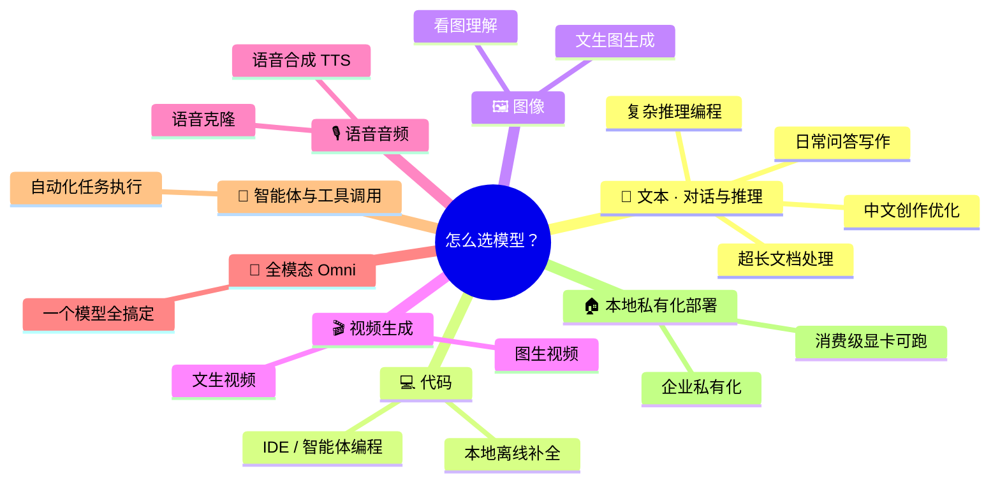
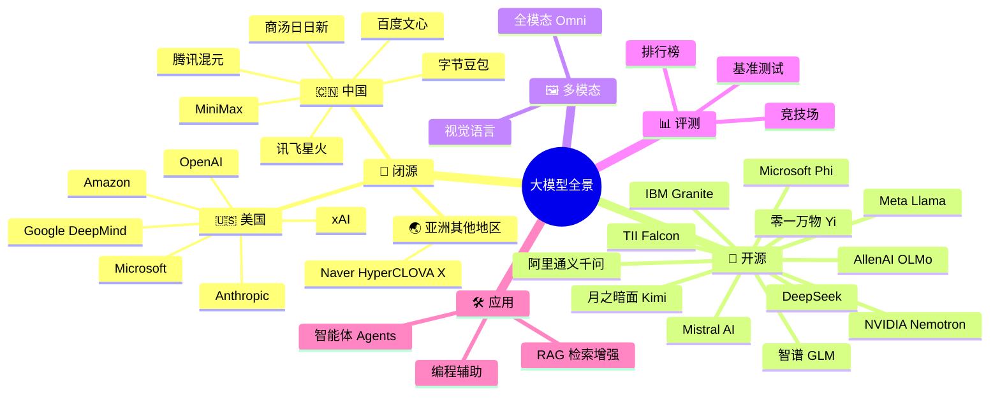
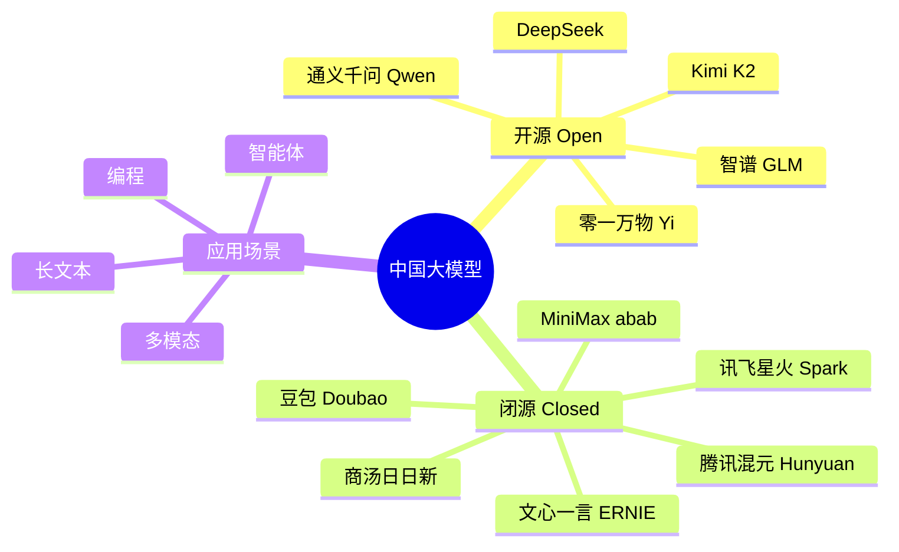

# 🧠 大模型全景图谱 (Awesome LLM Landscape)

  <a href="README.md">English</a> ・ <b>简体中文</b>

  
  
  
  

  <b>从你想做的事出发——聊天、写代码、生成图片、做视频、克隆声音——直接找到大家实际在用的那个模型。</b>

  🌐 <a href="https://hoobenwang.github.io/awesome-llm-landscape/"><b>在线交互式思维导图（GitHub Pages）</b></a>

大多数「awesome LLM」仓库都是按「谁做的模型」来组织的。这对你已经知道自己要什么的时候有用，但回答不了大多数人真正的问题：**「我要做 X，该用哪个模型？」** 这份仓库优先给你一张**按场景划分**的思维导图，直接回答这个问题；然后再提供一份完整的**按机构**目录（带 Logo，方便快速识别），满足你想看全貌的需求。

> 参考自 [uhub/awesome-llm](https://github.com/uhub/awesome-llm)、[hannibal046/Awesome-LLM](https://github.com/hannibal046/Awesome-LLM)、[Shubhamsaboo/awesome-llm-apps](https://github.com/Shubhamsaboo/awesome-llm-apps) 以及 [Awesome-LLM-Evaluation](https://alopatenko.github.io/LLMEvaluation/)。

## 目录

- [🎯 快速选型：你想做什么？](#-快速选型你想做什么)
  - [💬 文本：对话与推理](#-文本对话与推理)
  - [💻 代码](#-代码)
  - [🖼️ 图像](#️-图像)
  - [🎬 视频生成](#-视频生成)
  - [🎙️ 语音音频](#️-语音音频)
  - [🧩 全模态 Omni（一站式）](#-全模态-omni一站式)
  - [🤖 智能体与工具调用](#-智能体与工具调用)
  - [🏠 本地私有化部署](#-本地私有化部署)
- [📚 完整机构目录](#-完整机构目录)
- [📊 评测与榜单](#-评测与榜单)
- [🛠️ 用大模型做产品](#️-用大模型做产品)
- [🔗 相关 Awesome 列表](#-相关-awesome-列表)
- [🤝 贡献指南](#-贡献指南)

---

## 🎯 快速选型：你想做什么？

> 如果上方的思维导图在 GitHub 上显示为纯文本而非图表（GitHub 的 mermaid 渲染偶尔滞后），可以打开 [mermaid.live](https://mermaid.live) 或在 VS Code 中查看本文件。

注：下面图像/视频/语音生成这几类严格来说不算「语言模型」——它们是扩散模型或音频模型——但选模型时大家会放在一起比较，所以一并收录。

### 💬 文本：对话与推理

| 场景 | 推荐模型 | 为什么 |
|---|---|---|
| 日常问答 / 写作 | GPT-5、Claude 5 Sonnet、Gemini、豆包、通义千问 | 质量、速度、成本最均衡，适合日常使用 |
| 复杂推理 / 编程智能体 | Claude 5 Opus、GPT-5（o 系列）、DeepSeek-R1、通义千问 Max | 多步推理与长程规划能力最强 |
| 超长文档/代码库（20 万–100 万+ tokens） | Gemini、DeepSeek、通义千问、Kimi K2 | 原生长上下文，质量不会明显下降 |
| 中文写作与创意生成 | 文心一言、通义千问、豆包 | 专门针对中文语感与风格优化 |
| 隐私 / 本地部署 / 离线 | Llama 4、通义千问（开源）、DeepSeek-V3、智谱 GLM、Mistral | 下载权重，跑在自己的硬件上 |

### 💻 代码

| 场景 | 推荐模型 | 为什么 |
|---|---|---|
| IDE 智能体编程（规划、改代码、跑测试） | Claude 5（Sonnet/Opus）、GPT-5 | 在真实 issue 修复类基准上得分最高 |
| 本地/离线代码补全 | 通义千问-Coder、DeepSeek-Coder、Phi | 体积小，笔记本或单卡就能跑 |

### 🖼️ 图像

| 场景 | 推荐模型 | 为什么 |
|---|---|---|
| 看图/理解图像（视觉） | GPT-5（视觉）、Gemini、Claude 5、Qwen-VL、InternVL | 读懂截图、图表、文档、照片 |
| 文生图 | GPT Image（OpenAI）、Imagen（Google）、FLUX（Black Forest Labs）、Stable Diffusion、即梦/豆包（字节跳动） | 从照片级写实到快速低成本迭代都有覆盖 |

### 🎬 视频生成

| 场景 | 推荐模型 | 为什么 |
|---|---|---|
| 文生视频 | Sora 2（OpenAI）、Veo（Google DeepMind）、可灵 Kling（快手）、海螺 Hailuo（MiniMax） | 目前写实度与时长的第一梯队 |
| 图生视频/动画 | 可灵、海螺、Runway Gen-4 | 把一张静态图动画成短视频 |

### 🎙️ 语音音频

| 场景 | 推荐模型 | 为什么 |
|---|---|---|
| 语音合成 TTS | OpenAI 语音、ElevenLabs、MiniMax 语音 | 语调自然，覆盖多语言/口音 |
| 语音克隆 | ElevenLabs、MiniMax、CosyVoice（阿里巴巴） | 几秒参考音频即可克隆声音 |

### 🧩 全模态 Omni（一站式）

| 场景 | 推荐模型 | 为什么 |
|---|---|---|
| 一个模型搞定文本+图像+音频+视频输入输出 | GPT-5、Gemini、Qwen-Omni | 不用再拼接多个专用模型 |

### 🤖 智能体与工具调用

| 场景 | 推荐模型 | 为什么 |
|---|---|---|
| 自主执行多步任务、操作电脑/工具 | Claude 5（Agent/电脑操作）、智谱 GLM、Kimi K2、GPT-5（函数调用） | 多步规划 + 工具调用基准表现最强 |

### 🏠 本地私有化部署

| 场景 | 推荐模型 | 为什么 |
|---|---|---|
| 消费级显卡/笔记本可跑 | Phi、Gemma、通义千问小尺寸、Llama 小尺寸 | 1B–8B 级别，量化后本地可跑 |
| 企业私有化部署 | Llama 4、通义千问（开源）、DeepSeek-V3、智谱 GLM、Granite（IBM）、Falcon（TII） | Apache 2.0 类许可证，有企业级支持选项 |

---

## 📚 完整机构目录

想按公司浏览？这是同一份全景图按传统方式组织的版本。

### 🏢 闭源模型（Proprietary）

只能通过 API 或应用访问，不开放权重下载的旗舰模型。

| | 机构 | 模型家族 | 擅长 | 链接 |
|---|---|---|---|---|
|  | **OpenAI** 🇺🇸 | GPT-5 系列、o 系列推理模型 | 通用智能、编程、ChatGPT 生态 | [openai.com](https://openai.com) |
|  | **Anthropic** 🇺🇸 | Claude 5（Opus / Sonnet / Haiku） | 长上下文推理、编程智能体、安全对齐 | [anthropic.com](https://anthropic.com) |
|  | **Google DeepMind** 🇺🇸 | Gemini 系列 | 原生多模态、百万级上下文、深度绑定 Google 生态 | [deepmind.google](https://deepmind.google) |
|  | **xAI** 🇺🇸 | Grok 系列 | 实时 X/Twitter 数据接入、快速迭代 | [x.ai](https://x.ai) |
|  | **Amazon** 🇺🇸 | Nova 系列 | 低成本高吞吐，绑定 AWS Bedrock | [aws.amazon.com/bedrock](https://aws.amazon.com/bedrock) |
|  | **Microsoft** 🇺🇸 | Copilot（调度 OpenAI + 自研） | 企业办公 / Office 生态集成 | [microsoft.com/ai](https://www.microsoft.com/ai) |
|  | **Cohere** 🇨🇦 | Command R 系列 | 面向企业的检索增强（RAG）模型 | [cohere.com](https://cohere.com) |
|  | **百度** 🇨🇳 | 文心一言 ERNIE 系列 | 中文搜索与知识接地 | [yiyan.baidu.com](https://yiyan.baidu.com) |
|  | **字节跳动** 🇨🇳 | 豆包 Doubao | C 端产品、抖音生态 | [doubao.com](https://www.doubao.com) |
|  | **腾讯** 🇨🇳 | 混元 Hunyuan 系列 | 微信/游戏/云生态集成 | [hunyuan.tencent.com](https://hunyuan.tencent.com) |
|  | **商汤科技** 🇨🇳 | 日日新 SenseChat | 视觉起家，多模态感知 + 大模型能力强 | [sensetime.com](https://www.sensetime.com) |
|  | **科大讯飞** 🇨🇳 | 星火 Spark | 语音 + 语言，教育与政务场景 | [xfyun.cn](https://www.xfyun.cn) |
|  | **MiniMax** 🇨🇳 | abab 系列 | 长上下文对话、多模态智能体 | [minimax.io](https://www.minimax.io) |
|  | **Naver** 🇰🇷 | HyperCLOVA X | 韩语旗舰模型，中美之外的区域代表 | [clova.ai](https://clova.ai) |

### 🧩 开源模型（Open-Weight）

可下载权重、可微调、可私有化部署的模型。

| | 机构 | 模型家族 | 擅长 | 许可说明 | 链接 |
|---|---|---|---|---|---|
|  | **Meta** 🇺🇸 | Llama 4（Scout / Maverick / Behemoth） | 开源权重的事实标杆，生态与工具链极其丰富 | 社区自定义许可 | [llama.com](https://www.llama.com) |
|  | **Mistral AI** 🇫🇷 | Mistral Large / Small、Mixtral | 高效 MoE 架构，欧洲多语言能力强 | Apache 2.0（多数版本） | [mistral.ai](https://mistral.ai) |
|  | **DeepSeek** 🇨🇳 | DeepSeek-V3 / R1 | 以极低训练/推理成本达到第一梯队推理水平 | MIT / 开放权重 | [deepseek.com](https://www.deepseek.com) |
|  | **阿里巴巴** 🇨🇳 | 通义千问 Qwen 系列 | 尺寸覆盖广（0.5B–235B+），编程与多语言能力强 | Apache 2.0（多数尺寸） | [qwen.ai](https://qwen.ai) |
|  | **智谱 AI** 🇨🇳 | GLM 系列 | 智能体与工具调用，中英双语训练 | Apache 2.0（多数版本） | [zhipuai.cn](https://www.zhipuai.cn) |
|  | **月之暗面** 🇨🇳 | Kimi（K2） | 超长上下文、智能体/工具调用基准领先 | 修改版 MIT | [moonshot.ai](https://www.moonshot.ai) |
|  | **零一万物** 🇨🇳 | Yi 系列 | 中英双语、效率优先 | Apache 2.0 | [01.ai](https://www.01.ai) |
|  | **Microsoft** 🇺🇸 | Phi 系列 | 「数据最优」小模型，适合端侧/边缘部署 | MIT | [azure.microsoft.com/phi](https://azure.microsoft.com/en-us/products/phi) |
|  | **Google** 🇺🇸 | Gemma 系列 | 源自 Gemini 研究成果的轻量级开源模型 | Gemma 许可 | [ai.google.dev/gemma](https://ai.google.dev/gemma) |
|  | **NVIDIA** 🇺🇸 | Nemotron 系列 | 面向 NVIDIA GPU 优化/蒸馏，训练后处理工具链完善 | NVIDIA Open Model License | [nvidia.com/nemotron](https://www.nvidia.com/en-us/ai/nemotron/) |
|  | **IBM** 🇺🇸 | Granite 系列 | 面向企业，训练数据来源公开透明 | Apache 2.0 | [ibm.com/granite](https://www.ibm.com/granite) |
|  | **TII** 🇦🇪 | Falcon 系列 | 中东地区代表性开源模型，阿拉伯语与多语言能力强 | Apache 2.0（Falcon 2+） | [falconllm.tii.ae](https://falconllm.tii.ae) |
|  | **艾伦人工智能研究所** 🇺🇸 | OLMo 系列 | 「完全开放」——训练数据、代码、权重全部公开 | Apache 2.0 | [allenai.org/olmo](https://allenai.org/olmo) |

### 🇨🇳 国产大模型生态

单独梳理发展最快的中国市场，因为它同时横跨以上两张表。

| 优势场景 | 推荐模型 |
|---|---|
| 超长上下文（100 万+ tokens） | DeepSeek、通义千问 |
| 长上下文（20 万+ tokens） | Kimi K2 |
| 性价比最高的开源权重 | DeepSeek-V3 |
| C 端消费级产品 | 豆包 |
| 中文写作与创意生成 | 文心一言、通义千问 |
| 智能体 / 工具调用 | 智谱 GLM、Kimi |

## 📊 评测与榜单

选模型离不开评测标准，建议从这里入手：

- **[Awesome LLM Evaluation](https://alopatenko.github.io/LLMEvaluation/)** — 目前最全面的评测方法论、基准测试与论文合集。
- **[LMArena（原 Chatbot Arena）](https://lmarena.ai/)** — 众包人类盲测偏好排名。
- **MMLU / MMLU-Pro** — 通识学科知识基准。
- **GPQA Diamond** — 研究生水平推理测试题。
- **SWE-bench** — 真实 GitHub issue 修复能力，面向编程智能体。
- **LiveCodeBench** — 持续刷新、抗数据污染的编程基准。

## 🛠️ 用大模型做产品

想直接「用」这些模型而不只是了解它们？参考 **[Shubhamsaboo/awesome-llm-apps](https://github.com/Shubhamsaboo/awesome-llm-apps)**，里面有 50+ 可直接运行的项目：RAG 流水线、自主智能体、MCP 服务、语音智能体等。

## 🔗 相关 Awesome 列表

- [uhub/awesome-llm](https://github.com/uhub/awesome-llm)
- [hannibal046/Awesome-LLM](https://github.com/hannibal046/Awesome-LLM)
- [Shubhamsaboo/awesome-llm-apps](https://github.com/Shubhamsaboo/awesome-llm-apps)
- [Awesome-LLM-Evaluation](https://alopatenko.github.io/LLMEvaluation/)

## 🤝 贡献指南

发现新模型、Logo 不对、版本号过时，或者有我们没覆盖到的场景？非常欢迎提交 PR，详见 [CONTRIBUTING.md](CONTRIBUTING.md)。大模型行业变化很快，这份清单只有持续更新才有意义。

## 许可证

[MIT](LICENSE)
