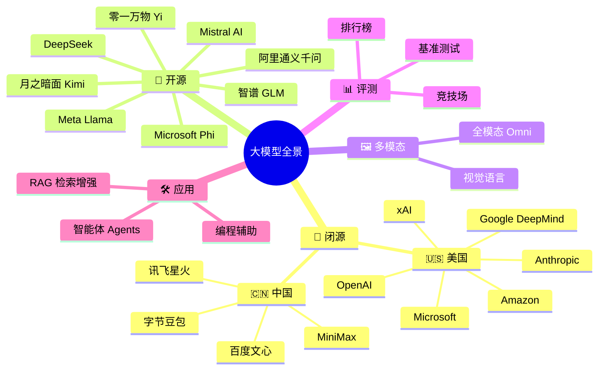
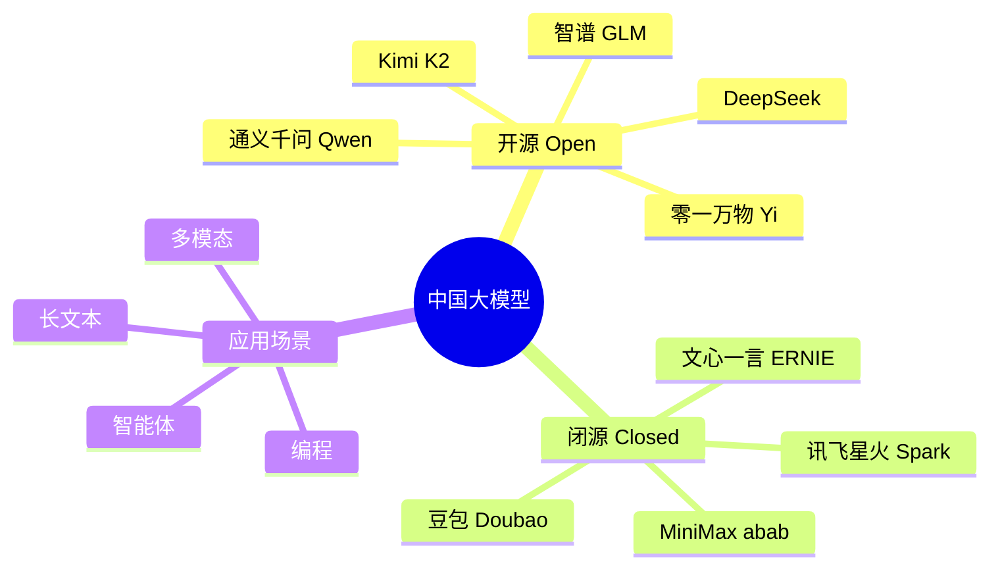

# 🧠 大模型全景图谱 (Awesome LLM Landscape)

  <a href="README.md">English</a> ・ <b>简体中文</b>

  
  
  
  

一份以<b>思维导图</b>呈现、带<b>品牌 Logo</b> 标识的主流大语言模型（LLM）全景指南——谁在做模型、各家擅长什么、彼此之间是什么关系，一目了然。

市面上多数「awesome LLM」仓库都是又长又平的列表，很难一眼看出全貌。这份仓库优先用**思维导图**呈现整体脉络，再用带 **Logo** 的表格方便快速识别，并附上评测与实战应用的参考链接。

> 参考自 [uhub/awesome-llm](https://github.com/uhub/awesome-llm)、[hannibal046/Awesome-LLM](https://github.com/hannibal046/Awesome-LLM)、[Shubhamsaboo/awesome-llm-apps](https://github.com/Shubhamsaboo/awesome-llm-apps) 以及 [Awesome-LLM-Evaluation](https://alopatenko.github.io/LLMEvaluation/)。

## 目录

- [🗺️ 思维导图总览](#️-思维导图总览)
- [🏢 闭源模型（Proprietary）](#-闭源模型proprietary)
- [🧩 开源模型（Open-Weight）](#-开源模型open-weight)
- [🇨🇳 国产大模型生态](#-国产大模型生态)
- [🖼️ 多模态模型](#️-多模态模型)
- [🛠️ 用大模型做产品](#️-用大模型做产品)
- [📊 评测与榜单](#-评测与榜单)
- [🔗 相关 Awesome 列表](#-相关-awesome-列表)
- [🤝 贡献指南](#-贡献指南)

---

## 🗺️ 思维导图总览

> 如果上方的思维导图在 GitHub 上显示为纯文本而非图表（GitHub 的 mermaid 渲染偶尔滞后），可以打开 [mermaid.live](https://mermaid.live) 或在 VS Code 中查看本文件。

下面每个分支都对应一张详情表：Logo 方便快速识别，附组织、模型家族、擅长领域和链接。

---

## 🏢 闭源模型（Proprietary）

只能通过 API 或应用访问，不开放权重下载的旗舰模型。

| | 机构 | 模型家族 | 擅长 | 链接 |
|---|---|---|---|---|
|  | **OpenAI** 🇺🇸 | GPT-5 系列、o 系列推理模型 | 通用智能、编程、ChatGPT 生态 | [openai.com](https://openai.com) |
|  | **Anthropic** 🇺🇸 | Claude 5（Opus / Sonnet / Haiku） | 长上下文推理、编程智能体、安全对齐 | [anthropic.com](https://anthropic.com) |
|  | **Google DeepMind** 🇺🇸 | Gemini 系列 | 原生多模态、百万级上下文、深度绑定 Google 生态 | [deepmind.google](https://deepmind.google) |
|  | **xAI** 🇺🇸 | Grok 系列 | 实时 X/Twitter 数据接入、快速迭代 | [x.ai](https://x.ai) |
|  | **Amazon** 🇺🇸 | Nova 系列 | 低成本高吞吐，绑定 AWS Bedrock | [aws.amazon.com/bedrock](https://aws.amazon.com/bedrock) |
|  | **Microsoft** 🇺🇸 | Copilot（调度 OpenAI + 自研） | 企业办公 / Office 生态集成 | [microsoft.com/ai](https://www.microsoft.com/ai) |
|  | **Cohere** 🇨🇦 | Command R 系列 | 面向企业的检索增强（RAG）模型 | [cohere.com](https://cohere.com) |
|  | **百度** 🇨🇳 | 文心一言 ERNIE 系列 | 中文搜索与知识接地 | [yiyan.baidu.com](https://yiyan.baidu.com) |
|  | **字节跳动** 🇨🇳 | 豆包 Doubao | C 端产品、抖音生态 | [doubao.com](https://www.doubao.com) |
|  | **科大讯飞** 🇨🇳 | 星火 Spark | 语音 + 语言，教育与政务场景 | [xfyun.cn](https://www.xfyun.cn) |
|  | **MiniMax** 🇨🇳 | abab 系列 | 长上下文对话、多模态智能体 | [minimax.io](https://www.minimax.io) |

## 🧩 开源模型（Open-Weight）

可下载权重、可微调、可私有化部署的模型。

| | 机构 | 模型家族 | 擅长 | 许可说明 | 链接 |
|---|---|---|---|---|---|
|  | **Meta** 🇺🇸 | Llama 4（Scout / Maverick / Behemoth） | 开源权重的事实标杆，生态与工具链极其丰富 | 社区自定义许可 | [llama.com](https://www.llama.com) |
|  | **Mistral AI** 🇫🇷 | Mistral Large / Small、Mixtral | 高效 MoE 架构，欧洲多语言能力强 | Apache 2.0（多数版本） | [mistral.ai](https://mistral.ai) |
|  | **DeepSeek** 🇨🇳 | DeepSeek-V3 / R1 | 以极低训练/推理成本达到第一梯队推理水平 | MIT / 开放权重 | [deepseek.com](https://www.deepseek.com) |
|  | **阿里巴巴** 🇨🇳 | 通义千问 Qwen 系列 | 尺寸覆盖广（0.5B–235B+），编程与多语言能力强 | Apache 2.0（多数尺寸） | [qwen.ai](https://qwen.ai) |
|  | **智谱 AI** 🇨🇳 | GLM 系列 | 智能体与工具调用，中英双语训练 | Apache 2.0（多数版本） | [zhipuai.cn](https://www.zhipuai.cn) |
|  | **月之暗面** 🇨🇳 | Kimi（K2） | 超长上下文、智能体/工具调用基准领先 | 修改版 MIT | [moonshot.ai](https://www.moonshot.ai) |
|  | **零一万物** 🇨🇳 | Yi 系列 | 中英双语、效率优先 | Apache 2.0 | [01.ai](https://www.01.ai) |
|  | **Microsoft** 🇺🇸 | Phi 系列 | 「数据最优」小模型，适合端侧/边缘部署 | MIT | [azure.microsoft.com/phi](https://azure.microsoft.com/en-us/products/phi) |
|  | **Google** 🇺🇸 | Gemma 系列 | 源自 Gemini 研究成果的轻量级开源模型 | Gemma 许可 | [ai.google.dev/gemma](https://ai.google.dev/gemma) |

## 🇨🇳 国产大模型生态

单独梳理发展最快的中国市场，因为它同时横跨以上两个分类。

| 优势场景 | 推荐模型 |
|---|---|
| 超长上下文（100 万+ tokens） | DeepSeek、通义千问 |
| 长上下文（20 万+ tokens） | Kimi K2 |
| 性价比最高的开源权重 | DeepSeek-V3 |
| C 端消费级产品 | 豆包 |
| 中文写作与创意生成 | 文心一言、通义千问 |
| 智能体 / 工具调用 | 智谱 GLM、Kimi |

## 🖼️ 多模态模型

不止于文本——支持视觉、音频乃至「全模态」任意输入输出的模型。

| | 模型 | 机构 | 支持模态 |
|---|---|---|---|
|  | GPT-5（多模态） | OpenAI | 文本、图像、音频、视频 |
|  | Gemini（原生多模态） | Google DeepMind | 文本、图像、音频、视频、代码执行 |
|  | Claude 5（视觉） | Anthropic | 文本、图像、PDF/文档 |
|  | Qwen-VL / Qwen-Omni | 阿里巴巴 | 文本、图像、视频、音频 |
|  | InternVL | 上海人工智能实验室 | 文本、图像（开源权重） |

## 🛠️ 用大模型做产品

想直接「用」这些模型而不只是了解它们？参考 **[Shubhamsaboo/awesome-llm-apps](https://github.com/Shubhamsaboo/awesome-llm-apps)**，里面有 50+ 可直接运行的项目：RAG 流水线、自主智能体、MCP 服务、语音智能体等。

## 📊 评测与榜单

选模型离不开评测标准，建议从这里入手：

- **[Awesome LLM Evaluation](https://alopatenko.github.io/LLMEvaluation/)** — 目前最全面的评测方法论、基准测试与论文合集。
- **[LMArena（原 Chatbot Arena）](https://lmarena.ai/)** — 众包人类盲测偏好排名。
- **MMLU / MMLU-Pro** — 通识学科知识基准。
- **GPQA Diamond** — 研究生水平推理测试题。
- **SWE-bench** — 真实 GitHub issue 修复能力，面向编程智能体。
- **LiveCodeBench** — 持续刷新、抗数据污染的编程基准。

## 🔗 相关 Awesome 列表

- [uhub/awesome-llm](https://github.com/uhub/awesome-llm)
- [hannibal046/Awesome-LLM](https://github.com/hannibal046/Awesome-LLM)
- [Shubhamsaboo/awesome-llm-apps](https://github.com/Shubhamsaboo/awesome-llm-apps)
- [Awesome-LLM-Evaluation](https://alopatenko.github.io/LLMEvaluation/)

## 🤝 贡献指南

发现新模型、Logo 不对、版本号过时？非常欢迎提交 PR，详见 [CONTRIBUTING.md](CONTRIBUTING.md)。大模型行业变化很快，这份清单只有持续更新才有意义。

## 许可证

[MIT](LICENSE)
