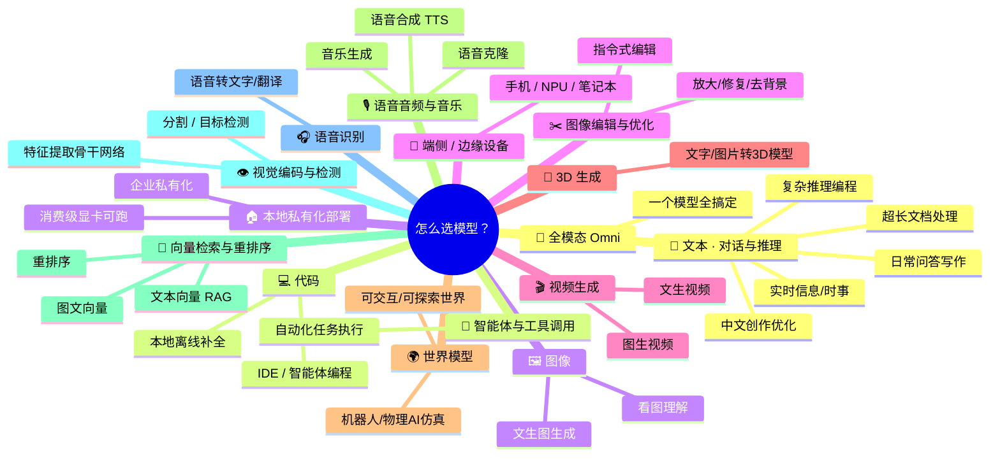
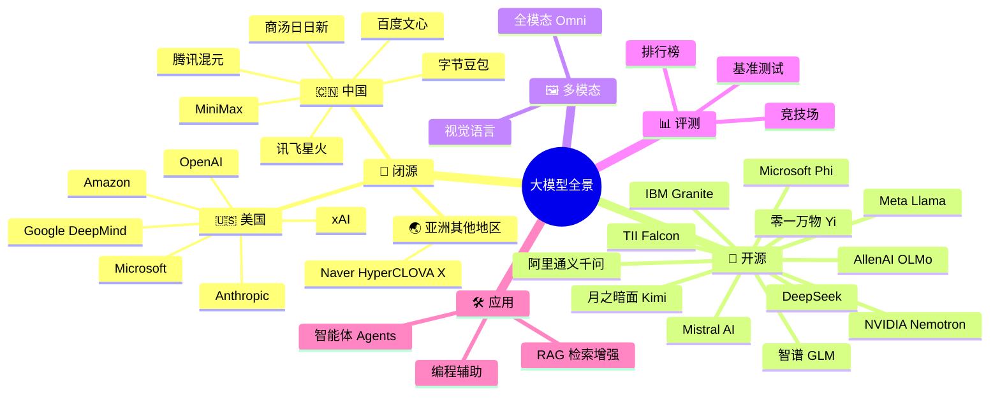

# 🧠 大模型全景图谱 (Awesome LLM Landscape)

  <a href="README.md">English</a> ・ <b>简体中文</b>

  
  
  
  

  <b>从你想做的事出发——聊天、写代码、生成图片、做视频、克隆声音——直接找到大家实际在用的那个模型。</b>

  🌐 <a href="https://hoobenwang.github.io/awesome-llm-landscape/"><b>在线交互式思维导图（GitHub Pages）</b></a>

大多数「awesome LLM」仓库都是按「谁做的模型」来组织的。这对你已经知道自己要什么的时候有用，但回答不了大多数人真正的问题：**「我要做 X，该用哪个模型？」** 这份仓库优先给你一张**按场景划分**的思维导图，直接回答这个问题；然后再提供一份完整的**按机构**目录（带 Logo，方便快速识别），满足你想看全貌的需求。

> 参考自 [uhub/awesome-llm](https://github.com/uhub/awesome-llm)、[hannibal046/Awesome-LLM](https://github.com/hannibal046/Awesome-LLM)、[Shubhamsaboo/awesome-llm-apps](https://github.com/Shubhamsaboo/awesome-llm-apps) 以及 [Awesome-LLM-Evaluation](https://alopatenko.github.io/LLMEvaluation/)。

## 目录

- [🎯 快速选型：你想做什么？](#-快速选型你想做什么)
  - [💬 文本：对话与推理](#-文本对话与推理)
  - [💻 代码](#-代码)
  - [🖼️ 图像](#️-图像)
  - [✂️ 图像编辑与优化](#️-图像编辑与优化)
  - [🎬 视频生成](#-视频生成)
  - [🧊 3D 生成](#-3d-生成)
  - [🌍 世界模型](#-世界模型)
  - [🎙️ 语音、音频与音乐](#️-语音音频与音乐)
  - [🔎 向量检索与重排序](#-向量检索与重排序)
  - [👁️ 视觉编码与检测](#️-视觉编码与检测)
  - [🎧 语音识别与翻译](#-语音识别与翻译)
  - [🧩 全模态 Omni（一站式）](#-全模态-omni一站式)
  - [🤖 智能体与工具调用](#-智能体与工具调用)
  - [🏠 本地私有化部署](#-本地私有化部署)
  - [📱 端侧 / 边缘设备模型](#-端侧--边缘设备模型)
- [📚 完整机构目录](#-完整机构目录)
- [📊 评测与榜单](#-评测与榜单)
- [🛠️ 用大模型做产品](#️-用大模型做产品)
- [🔗 相关 Awesome 列表](#-相关-awesome-列表)
- [🤝 贡献指南](#-贡献指南)

---

## 🎯 快速选型：你想做什么？

> 如果上方的思维导图在 GitHub 上显示为纯文本而非图表（GitHub 的 mermaid 渲染偶尔滞后），可以打开 [mermaid.live](https://mermaid.live) 或在 VS Code 中查看本文件。

注：下面图像/视频/语音生成这几类严格来说不算「语言模型」——它们是扩散模型或音频模型——但选模型时大家会放在一起比较，所以一并收录。

### 💬 文本：对话与推理

| 场景 | 推荐模型 | 为什么 |
|---|---|---|
| 日常问答 / 写作 | GPT-5、Claude 5 Sonnet、Gemini、豆包、通义千问 | 质量、速度、成本最均衡，适合日常使用 |
| 复杂推理 / 编程智能体 | Claude 5 Opus、GPT-5（o 系列）、DeepSeek-R1、通义千问 Max | 多步推理与长程规划能力最强 |
| 超长文档/代码库（20 万–100 万+ tokens） | Gemini、DeepSeek、通义千问、Kimi K3 | 原生长上下文，质量不会明显下降 |
| 中文写作与创意生成 | 文心一言、通义千问、豆包 | 专门针对中文语感与风格优化 |
| 隐私 / 本地部署 / 离线 | Llama 4、通义千问（开源）、DeepSeek-V3、智谱 GLM、Mistral | 下载权重，跑在自己的硬件上 |
| 实时信息 / 时事追踪 | Grok（xAI） | 直接、低延迟接入实时 X/Twitter 数据 |

### 💻 代码

| 场景 | 推荐模型 | 为什么 |
|---|---|---|
| IDE 智能体编程（规划、改代码、跑测试） | Claude 5（Sonnet/Opus）、GPT-5 | 在真实 issue 修复类基准上得分最高 |
| 本地/离线代码补全 | 通义千问-Coder、DeepSeek-Coder、Phi | 体积小，笔记本或单卡就能跑 |
| 代码专项旗舰 | Codestral（Mistral） | 代码基准分数高，但⚠️使用 Mistral 的**非商用许可证**（仅限研究/测试，不是标准开源许可证） |

### 🖼️ 图像

| 场景 | 推荐模型 | 为什么 |
|---|---|---|
| 看图/理解图像（视觉） | GPT-5（视觉）、Gemini、Claude 5、Qwen-VL、InternVL | 读懂截图、图表、文档、照片 |
| 文生图 | Midjourney、GPT Image（OpenAI）、Imagen（Google）、FLUX（Black Forest Labs）、Stable Diffusion、即梦/豆包（字节跳动） | 从照片级写实到快速低成本迭代都有覆盖 |
| 商用安全/企业级（知识产权有保障） | [Adobe Firefly](https://www.adobe.com/products/firefly.html) | 仅用授权/Adobe Stock 内容训练，企业使用有完整知识产权赔偿保障 |
| 图片内文字渲染准确（海报、标识、界面原型） | [Ideogram](https://ideogram.ai) | 在生成图像中渲染清晰、准确文字/排版的能力数一数二 |
| 矢量图/SVG 输出，适合设计工作 | [Recraft](https://www.recraft.ai) | 原生导出可编辑路径的 SVG 矢量图，支持品牌色板控制 |
| 开源权重/可本地部署的图像生成 | Stable Diffusion、FLUX.1 [dev]（Black Forest Labs）、Kolors 2.1（快手） | 下载权重本地跑——注意 FLUX [dev] 是**仅限非商用的许可证** |

### ✂️ 图像编辑与优化

用指令修改一张**已有**图片，或者做图像清理——和上面「从零生成」不是一回事。

| 模型 | 机构 | 擅长 | 许可证 / 注意事项 | 链接 |
|---|---|---|---|---|
| FLUX.1 Kontext | Black Forest Labs | 指令式图像编辑（比如「把左边那个人去掉」） | [dev]：开源权重，**仅限非商用**；[pro]/[max]：仅限 API | [bfl.ai/models/flux-kontext](https://bfl.ai/models/flux-kontext) |
| Gemini Flash Image（"Nano Banana"） | Google | 对话式图像编辑+生成，速度快，提示词遵循度高 | 闭源，仅限 API | [ai.google.dev/gemini-api/docs/models/gemini-2.5-flash-image](https://ai.google.dev/gemini-api/docs/models/gemini-2.5-flash-image) |
| Qwen-Image-Edit | 阿里巴巴 | 语义+外观编辑，多人物场景一致性强 | 开源权重——具体许可证因版本而异，请查看模型卡 | [huggingface.co/Qwen/Qwen-Image-Edit-2511](https://huggingface.co/Qwen/Qwen-Image-Edit-2511) |
| GPT Image（编辑/局部重绘） | OpenAI | 基于蒙版的局部重绘、多轮编辑、支持多张参考图 | 闭源，仅限 API | [openai.com](https://openai.com) |
| Adobe Firefly（创成式填充） | Adobe | 直接集成在 Photoshop 里；也接入第三方模型（GPT Image、Nano Banana、FLUX） | 闭源/商用，企业有知识产权赔偿保障 | [helpx.adobe.com/firefly](https://helpx.adobe.com/firefly/web/work-with-images/edit-images/generative-fill.html) |
| Real-ESRGAN / GFPGAN | 开源社区 | 图像放大（Real-ESRGAN）+ 人脸修复（GFPGAN）——ComfyUI/Automatic1111/Upscayl 默认搭配 | 开源 | [github.com/xinntao/Real-ESRGAN](https://github.com/xinntao/Real-ESRGAN) · [github.com/TencentARC/GFPGAN](https://github.com/TencentARC/GFPGAN) |
| Remove.bg / BRIA RMBG 2.0 | remove.bg / BRIA AI | 背景去除——Remove.bg 是精度更高（约97%）的闭源 API；RMBG 2.0 是开源权重（约92%） | RMBG 2.0：**CC BY-NC-4.0，仅限非商用** | [remove.bg](https://www.remove.bg) · [github.com/Bria-AI/RMBG-2.0](https://github.com/Bria-AI/RMBG-2.0) |

### 🎬 视频生成

| 场景 | 推荐模型 | 为什么 |
|---|---|---|
| 文生视频 | Sora 2（OpenAI）、Veo（Google DeepMind）、可灵 Kling（快手）、海螺 Hailuo（MiniMax）、Luma Dream Machine、[Pika](https://pika.art) | 目前写实度与时长的第一梯队 |
| 图生视频/动画 | 可灵、海螺、Runway Gen-4、Luma | 把一张静态图动画成短视频 |
| 开源权重/可本地部署的视频生成 | Wan2.2 万相（阿里巴巴，Apache 2.0）、HunyuanVideo 混元视频（腾讯）、CogVideoX（智谱/清华 THUDM）、LTX-Video（Lightricks） | 下载权重本地跑——真正开放，不像上面这些都是闭源的 |

### 🧊 3D 生成

文字或图片 → 3D 模型。在游戏开发、VFX、电商产品可视化场景越来越主流——和下面的世界模型不同，世界模型生成的是可探索的**环境**，这里生成的是单个可导出的 3D 资产。

| 模型 | 机构 | 擅长 | 许可证 / 注意事项 | 链接 |
|---|---|---|---|---|
| Tripo | VAST | 快速生成网格+PBR材质（最高 200 万面）；适合游戏资产快速迭代 | 闭源，API/SaaS | [tripo3d.ai](https://www.tripo3d.ai) |
| Meshy | Meshy LLC | 导出格式支持最全；自研「Meshy Edit」支持部件级编辑 | 闭源，API/SaaS | [meshy.ai](https://www.meshy.ai) |
| Rodin（Hyper3D） | Deemos | 100亿参数扩散 Transformer；在多项对比中排名照片级真实感/可直接用于生产的第一梯队 | 闭源，API/按点数计费 | [hyper3d.ai](https://hyper3d.ai) |
| Hunyuan3D 2.1 | 腾讯 | 真正开源权重的 3D 生成模型 | 腾讯混元 3D 社区许可证（允许商用，需署名）；**更新的 2.5/3.0 版本仅限 API**——不要和这个开源的 2.1 版本搞混 | [github.com/Tencent-Hunyuan/Hunyuan3D-2.1](https://github.com/Tencent-Hunyuan/Hunyuan3D-2.1) |
| TRELLIS.2 | 微软 | 40亿参数图生3D，支持 PBR 材质，体素分辨率最高 1536³ | MIT（真正宽松） | [github.com/microsoft/TRELLIS.2](https://github.com/microsoft/TRELLIS.2) |
| Stable Point Aware 3D（SPAR3D） | Stability AI | 单张图片实时生成 3D，支持背面补全 | Stability AI 社区许可证——使用前请核实商业营收门槛条款 | [github.com/Stability-AI/stable-point-aware-3d](https://github.com/Stability-AI/stable-point-aware-3d) |

> Luma AI 原本也有一款同名「Genie」的 3D 产品，但已于 **2026 年 1 月 1 日停止服务**——注意不要和下面 Google DeepMind 的 **Genie 4** 世界模型搞混，同名但完全是两家不同公司的不同产品。

### 🌍 世界模型

和上面的视频生成不同：这类模型不是生成一段线性的视频片段，而是生成一个你（或智能体）可以**实时探索、交互**的环境。

| 场景 | 推荐模型 | 为什么 |
|---|---|---|
| 可交互/可探索的生成式世界 | [Genie 4](https://deepmind.google/models/genie/)（Google DeepMind）、[Marble](https://worldlabs.ai)（World Labs）、[Oasis 2.0](https://oasis-model.github.io/)（Decart + Etched） | 从一句提示或一张图片实时生成可探索的 3D/游戏式世界，而不只是看一段视频 |
| 机器人/物理 AI 仿真 | [NVIDIA Cosmos 3](https://www.nvidia.com/en-us/ai/cosmos/) | 面向物理推理与动作预测的开放世界基础模型，提供 Super/Nano/Edge 多种尺寸 |

> 这个方向变化很快，还有几家（腾讯混元世界、Runway 的通用世界模型研究、Odyssey）正在冒头，但官方信息还不够确凿，暂不收录链接，值得持续关注。另外：Meta 的 **V-JEPA2**（见上文[视觉编码与检测](#️-视觉编码与检测)）也被 Meta 定位为用于物理推理的「世界模型」；Google DeepMind 的 **SIMA 2** 是另一个相关但不同的东西——它是一个**在** Genie 这类世界里行动的智能体，而不是生成世界的模型本身。
>
> **相关且值得了解——机器人基础模型：** [π0 / π0.5](https://www.physicalintelligence.company/blog/pi0)（Physical Intelligence）和 [Helix](https://www.figure.ai/news/helix)（Figure AI）是面向真实机器人/人形机器人控制的视觉-语言-动作模型——和世界模型（模拟环境）是不同的方向，但解决的是相关的「物理 AI」问题。

### 🎙️ 语音、音频与音乐

| 场景 | 推荐模型 | 为什么 |
|---|---|---|
| 语音合成 TTS | OpenAI 语音、ElevenLabs、MiniMax 语音 | 语调自然，覆盖多语言/口音 |
| 语音克隆 | ElevenLabs、MiniMax、CosyVoice（阿里巴巴） | 几秒参考音频即可克隆声音 |
| 完整歌曲生成（人声+伴奏） | Suno、Udio、[ElevenLabs Music](https://elevenlabs.io/music)、[Lyria](https://ai.google.dev/gemini-api/docs/models/lyria-3.5)（Google） | 一句文字提示生成可直接商用的完整歌曲（60秒–3分钟） |
| 开源权重/可本地部署的音乐生成 | [MusicGen / AudioCraft](https://github.com/facebookresearch/audiocraft)（Meta）、[Stable Audio](https://stability.ai/stable-audio)（Stability AI） | 本地跑，不依赖 API——AudioCraft 完全开放权重 |

### 🔎 向量检索与重排序

RAG、搜索、「找相似」这类功能背后都是这类模型——它们把文本或图像转成向量，而不是生成文字。

| 场景 | 推荐模型 | 为什么 |
|---|---|---|
| 文本向量化（RAG/搜索） | OpenAI text-embedding-3、Cohere Embed、BGE（智源 BAAI）、Qwen-Embedding、Voyage AI、Jina Embeddings | 把文本映射成向量，用于语义搜索与检索 |
| 完全开放（数据+代码+权重），长上下文 | Nomic Embed | 8K token 上下文，Apache 2.0，训练过程完全可复现 |
| MTEB 多语言榜单靠前 | GTE（阿里巴巴）、E5（微软）、Snowflake Arctic Embed | 通用检索精度强，均为 Apache 2.0 / MIT 许可 |
| 追求极致精度，仅限研究用途 | NV-Embed（NVIDIA） | 曾登顶 MTEB 榜首——但**仅限非商业使用**（CC-BY-NC-4.0），不能用于生产环境 |
| 高效/可量化，适合大规模部署 | mxbai-embed（Mixedbread AI） | 支持俄罗斯套娃（Matryoshka）+ 二值量化，向量存储成本大幅降低而精度几乎不变 |
| 图文向量（Vision-Language Embedding） | SigLIP / SigLIP2（Google）、CLIP（OpenAI） | 把图像和文本映射到同一向量空间——零样本分类、以图搜图 |
| 一个模型覆盖文本/代码/图像/视频/音频向量化 | EmbeddingGemma（Google，Gemma 4 家族成员） | 统一的向量空间，不用为每种模态单独拼接一个模型 |
| 检索结果重排序 | Cohere Rerank、BGE-reranker（智源）、Jina Reranker | 对候选结果重新打分，精度远高于只用向量检索 |

> 这类模型通常用 `sentence-transformers`、`transformers` 部署，或者导出为 **ONNX** 格式用 ONNX Runtime 做 CPU/边缘端快速推理。ONNX 本身是一种模型**格式/运行时**，不是某个具体模型——所以这里不会把它列成一行，但在上面这些模型、以及下面[本地私有化部署](#-本地私有化部署)里的小尺寸开源对话模型的部署文档里，你会经常看到它。

### 👁️ 视觉编码与检测

这些不是对话模型，也不是图像生成模型——而是其他视觉应用背后的「基础构件」：通用特征提取、分割、目标检测。其中几个在授权协议上有些坑，值得了解清楚再决定要不要用在产品里。

| 模型 | 机构 | 擅长 | 许可证 / 注意事项 | 链接 |
|---|---|---|---|---|
| DINOv2 / DINOv3 | Meta AI | 自监督视觉骨干网络——不需要标注数据，通用视觉特征能力强 | DINOv2：Apache 2.0 · **DINOv3：自定义许可证**，需要「Built with DINOv3」署名 + 申请访问权限 | [ai.meta.com/research/dinov3](https://ai.meta.com/research/dinov3/) |
| I-JEPA / V-JEPA2 | Meta AI (FAIR) | 预测「表示」而非像素（JEPA 架构）——图像（I-JEPA）和视频（V-JEPA2）高效自监督学习 | 研究许可证——商用前请先核实条款 | [ai.meta.com/blog/yann-lecun-ai-model-i-jepa](https://ai.meta.com/blog/yann-lecun-ai-model-i-jepa/) |
| AIMv2 | Apple | 自回归多模态视觉编码器——在多模态图像理解基准上超过 CLIP/SigLIP | Apple 研究/示例代码条款（非标准开源许可——商用前请核实） | [github.com/apple/ml-aim](https://github.com/apple/ml-aim) |
| EVA-CLIP | 智源 BAAI | 大规模 CLIP 训练方案——EVA-CLIP-18B 是目前最大的开源 CLIP 模型 | MIT | [github.com/baaivision/EVA](https://github.com/baaivision/EVA) |
| Segment Anything（SAM2 / SAM3） | Meta AI | 可提示的图像/视频分割——SAM3 支持基于文本/概念的分割 | SAM2：Apache 2.0 · **SAM3：受限的「SAM License」**（更严格，需申请 HF 访问权限） | [ai.meta.com/research/sam3](https://ai.meta.com/research/sam3/) |
| Grounding DINO | IDEA Research | 开放词汇目标检测——用文字描述检测物体，而不局限于固定标签集 | Apache 2.0 | [github.com/IDEA-Research/GroundingDINO](https://github.com/IDEA-Research/GroundingDINO) |
| YOLO26 | Ultralytics | 当前旗舰级实时目标检测器——免 NMS，CPU 上也能快速推理 | **AGPL-3.0**（著佐权/copyleft），开源用途免费；闭源商用需购买商业许可证 | [docs.ultralytics.com/models/yolo26](https://docs.ultralytics.com/models/yolo26) |
| PaddleOCR（+ RapidOCR） | 百度（飞桨 PaddlePaddle） | 最常用的开源 OCR——把图片/PDF 转成结构化文字，支持 100+ 语言；RapidOCR 是常搭配使用的轻量级 ONNX 版本 | Apache 2.0（两者均是） | [github.com/PaddlePaddle/PaddleOCR](https://github.com/PaddlePaddle/PaddleOCR) · [github.com/RapidAI/RapidOCR](https://github.com/RapidAI/RapidOCR) |
| InsightFace | DeepInsight（开源社区） | 事实标准的人脸检测/识别/分析工具包（年龄、性别、关键点等） | 仓库未声明统一开源许可证——部分预训练模型包仅限研究/非商用，商用前请逐一核实 | [github.com/deepinsight/insightface](https://github.com/deepinsight/insightface) |

### 🎧 语音识别与翻译

与上面的语音合成模型相对——把语音转成文字（或转成另一种语言）。

| 模型 | 机构 | 擅长 | 许可证 / 注意事项 | 链接 |
|---|---|---|---|---|
| Whisper | OpenAI | 通用多语言语音识别 + 翻译 + 语种识别 | MIT | [github.com/openai/whisper](https://github.com/openai/whisper) |
| SeamlessM4T | Meta AI | 一个模型搞定约 100 种语言的语音/文本互译 | 研究/非商业许可——商用前请核实具体条款 | [ai.meta.com/resources/models-and-libraries/seamless-communication-models](https://ai.meta.com/resources/models-and-libraries/seamless-communication-models/) |
| Paraformer / FunASR | 阿里巴巴达摩院 | 中文优先的语音识别工具包——同时支持 VAD、标点、说话人识别 | MIT | [github.com/modelscope/FunASR](https://github.com/modelscope/FunASR) |
| Qwen-Audio / Qwen3-Omni | 阿里巴巴 | 理解语音、音乐与声音；Qwen3-Omni 原生支持 19 种语言的语音输入、10 种语言的语音输出 | Apache 2.0（具体版本有差异） | [qwen.ai](https://qwen.ai) |
| NVIDIA Canary / Parakeet | NVIDIA | 多语言语音识别+翻译（Canary，25 种语言）与快速流式识别（Parakeet） | 通常为 CC-BY-4.0——请按具体版本核实 | [huggingface.co/nvidia](https://huggingface.co/nvidia) |
| Chirp 3 | Google Cloud | 企业级语音识别——20 亿参数，24 种正式支持+77 种以上预览语言，说话人分离能力强 | Google Cloud API（非开源权重） | [cloud.google.com/speech-to-text](https://cloud.google.com/speech-to-text) |

> **顺带一提，很有名的另一个「基础模型」：** [AlphaFold](https://deepmind.google/science/alphafold/)（Google DeepMind）大概是语言/视觉/语音之外，整个 AI 领域里最出名的「基础模型」——它能根据氨基酸序列预测蛋白质的三维结构，其创造者也因此获得了 2024 年诺贝尔化学奖。AlphaFold 2 的代码是 Apache 2.0，但 AlphaFold 3 的模型权重仅能通过 AlphaFold Server 以非商业方式使用。再提几个各自领域里很出名的基础模型（我们专门查过金融和法律领域有没有真正独立训练、非套壳的行业模型，结论是没有够格的——BloombergGPT 已被搁置不用，FinGPT 只是 LoRA 微调适配器，法律 AI 工具清一色是在 GPT/Claude 上做 RAG 或微调）：[WeatherNext 3](https://developers.google.com/weathernext)（Google DeepMind，GraphCast 的现役旗舰继任者——已经在 Google 搜索/地图/Gemini 的天气预报里实际使用）、[ESM3](https://www.evolutionaryscale.ai)（EvolutionaryScale，同时对蛋白质的序列/结构/功能进行推理——小尺寸的「ESM3-open」1.4B 版本是 MIT 许可，但旗舰版模型仅限非商业使用）、[AlphaChip](https://deepmind.google/blog/how-alphachip-transformed-computer-chip-design/)（Google DeepMind——强化学习芯片布局设计，已在 5 代 Google TPU 的生产环境中使用，联发科 MediaTek 也独立采用了这套方法）以及 [AlphaProof](https://deepmind.google/blog/ai-solves-imo-problems-at-silver-medal-level/)（Google DeepMind——形式化数学推理，最新版本在 2026 年国际数学奥林匹克竞赛题目上拿到 5/6 分）。

### 🧩 全模态 Omni（一站式）

| 场景 | 推荐模型 | 为什么 |
|---|---|---|
| 一个模型搞定文本+图像+音频+视频输入输出 | GPT-5、Gemini、Qwen-Omni | 不用再拼接多个专用模型 |

### 🤖 智能体与工具调用

| 场景 | 推荐模型 | 为什么 |
|---|---|---|
| 自主执行多步任务、操作电脑/工具 | Claude 5（Agent/电脑操作）、智谱 GLM、Kimi K3、GPT-5（函数调用） | 多步规划 + 工具调用基准表现最强 |

### 🏠 本地私有化部署

| 场景 | 推荐模型 | 为什么 |
|---|---|---|
| 消费级显卡/笔记本可跑（1B–8B） | 通义千问 Qwen3（0.6B–8B）、Llama 3.2（1B/3B）、Phi-4-mini、Gemma 3（1B–12B） | 当前这一代小尺寸指令模型，量化后本地可跑 |
| 手机 / 端侧 / 边缘设备 | MiniCPM、Gemma 3n、SmolLM2/SmolLM3（Hugging Face） | 专门针对手机和资源受限的边缘硬件调优，不只是「尺寸小」——详见下方[端侧/边缘设备模型](#-端侧--边缘设备模型)表格 |
| 轻量级多模态（小尺寸视觉语言模型） | SmolVLM、Moondream、PaliGemma 2（Google） | 图像理解能力在普通硬件上也能跑起来 |
| 企业私有化部署 | Llama 4、通义千问（开源）、DeepSeek-V3、智谱 GLM、Granite（IBM）、Falcon（TII） | Apache 2.0 类许可证，有企业级支持选项 |

### 📱 端侧 / 边缘设备模型

这不只是「小」——这些模型是专门为手机、笔记本 NPU 或嵌入式芯片打造的，往往由硬件/系统厂商自己出品，部署方式也和「下载一个 .safetensors 文件」不一样。

| 模型 | 机构 | 「端侧」特性 | 开源/闭源 | 链接 |
|---|---|---|---|---|
| Apple Foundation Models | 苹果 | 驱动 iPhone/iPad/Mac 上的 Siri/Apple Intelligence；现已通过 Foundation Models 框架（Swift API）开放给第三方应用调用 | 闭源，仅限 API | [developer.apple.com/documentation/foundationmodels](https://developer.apple.com/documentation/foundationmodels) |
| MiniCPM | 面壁智能 / 清华 | 成熟、被广泛部署的端侧大模型——真正能跑在手机上，不只是「参数小」 | Apache 2.0 | [github.com/OpenBMB/MiniCPM](https://github.com/OpenBMB/MiniCPM) |
| Gemini Nano | Google | 驱动 Pixel/Android 端侧功能（Recorder 摘要、Gboard 等）；通过 AICore 系统服务运行，开发者可通过 ML Kit GenAI API 调用 | 闭源，仅限 API | [developers.google.com/ml-kit/genai](https://developers.google.com/ml-kit/genai) |
| Gauss2 Compact | 三星 | 三星「三层模型」中专为端侧设计的一层，驱动 Galaxy AI；多模态（语言+代码+图像），支持 9–14 种语言 | 闭源，与 Galaxy 设备深度集成 | [news.samsung.com](https://news.samsung.com/global/samsung-electronics-hosts-samsung-developer-conference-korea-2024-unveils-its-improved-gen-ai-model) |
| BlueLM 蓝心大模型（约 1B 端侧版本） | vivo AI Lab | 专门为端侧打造的小模型，区别于 vivo 更大的云端模型——真实开源权重发布，不只是营销噱头 | 开源权重，**未声明明确许可证**（GitHub 显示 "NOASSERTION"）——商用前请核实 | [github.com/vivo-ai-lab/BlueLM](https://github.com/vivo-ai-lab/BlueLM) |
| Aion Instruct（取代 Phi Silica） | 微软 | 面向 Copilot+ PC 的 NPU/GPU/CPU 模型；原本仅支持 NPU 的 Phi Silica 将在 2027 年 1 月前被其取代 | 闭源，与 Windows 深度集成 | [learn.microsoft.com/windows/ai/apis/phi-silica](https://learn.microsoft.com/en-us/windows/ai/apis/phi-silica) |
| LFM2.5 | Liquid AI | 非 Transformer 架构（液态/混合架构），明确定位为「设备原生」模型——230M 到 24B-A2B MoE 不等，还有图文边缘变体 | 开源权重（具体许可证因版本而异——使用前请核实） | [liquid.ai](https://www.liquid.ai/) |
| Ministral 3（3B/8B/14B） | Mistral AI | 明确为「边缘与本地场景」打造——笔记本、RTX PC、Jetson 设备 | Apache 2.0 | [mistral.ai/news/mistral-3](https://mistral.ai/news/mistral-3/) |
| Falcon-Edge（Falcon-E） | TII | 1B/3B，三元 BitNet 架构（1.58-bit 权重）——专为 CPU（而非 GPU）运行设计 | 许可证未确认——请查看 HF 模型卡 | [huggingface.co/blog/tiiuae/falcon-edge](https://huggingface.co/blog/tiiuae/falcon-edge) |

> **以下是部署平台/工具，不是模型**，别搞混了：**Qualcomm AI Hub**（把 300+ 个开源模型编译适配到骁龙 NPU/GPU/CPU 上运行）、**Intel OpenVINO** 和 **AMD Ryzen AI Software**（分别是 Intel Core Ultra 和 AMD Ryzen AI NPU 的对应工具链——至此苹果/谷歌/高通/Intel/AMD 五大 NPU 厂商就齐了）、**llama.cpp / GGUF**（把模型量化到能在 CPU/边缘硬件上跑的标准格式）、**Core ML / LiteRT（原 TensorFlow Lite）/ MediaPipe**（苹果和谷歌各自的移动端推理运行时）。和前面 ONNX 那条注释是一个道理——它们都是在跑 MiniCPM、通义千问、Gemma、Whisper（本仓库都已收录）这类模型，而不是模型本身。
>
> **NAS「AI 相册」类应用**没有自己专属的模型——具体扒了一下各家实际用的是什么：**群晖 Synology Photos** 跑的是 OpenCV 的 DNN 模块 + TensorFlow Lite + ONNX Runtime，纯 Celeron CPU 就能跑；**威联通 QNAP QuMagie** 用的是 **Google ML Kit Face Detection**（经典的非生成式人脸检测 SDK，不是 Gemini Nano）做本地人脸检测；**绿联（UGREEN）新出的 AI NAS 产品线**是这几家里最「大模型化」的，直接内置了本仓库通义千问系列里的 **Qwen3.5-4B**，通过 llama.cpp 跑推理。像 [TrailSnap](https://github.com/LC044/TrailSnap) 这类自托管应用也是同样的模式，用的就是上面[视觉编码与检测](#️-视觉编码与检测)里那套开源 CV 模型（PaddleOCR、InsightFace、CLIP、YOLO）。

---

## 📚 完整机构目录

想按公司浏览？这是同一份全景图按传统方式组织的版本。

### 🏢 闭源模型（Proprietary）

只能通过 API 或应用访问，不开放权重下载的旗舰模型。

| | 机构 | 模型家族 | 擅长 | 链接 |
|---|---|---|---|---|
|  | **OpenAI** 🇺🇸 | GPT-5 系列、o 系列推理模型 | 通用智能、编程、ChatGPT 生态 | [openai.com](https://openai.com) |
|  | **Anthropic** 🇺🇸 | Claude 5（Opus / Sonnet / Haiku） | 长上下文推理、编程智能体、安全对齐 | [anthropic.com](https://anthropic.com) |
|  | **Google DeepMind** 🇺🇸 | Gemini 系列 | 原生多模态、百万级上下文、深度绑定 Google 生态 | [deepmind.google](https://deepmind.google) |
|  | **xAI** 🇺🇸 | Grok 系列 | 实时 X/Twitter 数据接入、快速迭代 | [x.ai](https://x.ai) |
|  | **Amazon** 🇺🇸 | Nova 系列 | 低成本高吞吐，绑定 AWS Bedrock | [aws.amazon.com/bedrock](https://aws.amazon.com/bedrock) |
|  | **Microsoft** 🇺🇸 | Copilot（调度 OpenAI + 自研） | 企业办公 / Office 生态集成 | [microsoft.com/ai](https://www.microsoft.com/ai) |
|  | **Cohere** 🇨🇦 | Command R 系列 | 面向企业的检索增强（RAG）模型 | [cohere.com](https://cohere.com) |
|  | **百度** 🇨🇳 | 文心一言 ERNIE 系列 | 中文搜索与知识接地 | [yiyan.baidu.com](https://yiyan.baidu.com) |
|  | **字节跳动** 🇨🇳 | 豆包 Doubao | C 端产品、抖音生态 | [doubao.com](https://www.doubao.com) |
|  | **腾讯** 🇨🇳 | 混元 Hunyuan 系列 | 微信/游戏/云生态集成 | [hunyuan.tencent.com](https://hunyuan.tencent.com) |
|  | **商汤科技** 🇨🇳 | 日日新 SenseChat | 视觉起家，多模态感知 + 大模型能力强 | [sensetime.com](https://www.sensetime.com) |
|  | **科大讯飞** 🇨🇳 | 星火 Spark | 语音 + 语言，教育与政务场景 | [xfyun.cn](https://www.xfyun.cn) |
|  | **MiniMax** 🇨🇳 | abab 系列 | 长上下文对话、多模态智能体 | [minimax.io](https://www.minimax.io) |
|  | **Naver** 🇰🇷 | HyperCLOVA X | 韩语旗舰模型，中美之外的区域代表 | [clova.ai](https://clova.ai) |

### 🧩 开源模型（Open-Weight）

可下载权重、可微调、可私有化部署的模型。

| | 机构 | 模型家族 | 擅长 | 许可说明 | 链接 |
|---|---|---|---|---|---|
|  | **Meta** 🇺🇸 | Llama 4（Scout / Maverick / Behemoth） | 开源权重的事实标杆，生态与工具链极其丰富 | 社区自定义许可 | [llama.com](https://www.llama.com) |
|  | **Mistral AI** 🇫🇷 | Mistral Large / Small、Mixtral | 高效 MoE 架构，欧洲多语言能力强 | Apache 2.0（多数版本） | [mistral.ai](https://mistral.ai) |
|  | **DeepSeek** 🇨🇳 | DeepSeek-V3 / R1 | 以极低训练/推理成本达到第一梯队推理水平 | MIT / 开放权重 | [deepseek.com](https://www.deepseek.com) |
|  | **阿里巴巴** 🇨🇳 | 通义千问 Qwen 系列 | 尺寸覆盖广（0.5B–235B+），编程与多语言能力强 | Apache 2.0（多数尺寸） | [qwen.ai](https://qwen.ai) |
|  | **智谱 AI（已改名 "Z.ai"）** 🇨🇳 | GLM 系列 | 智能体与工具调用，中英双语训练；开发者/API 平台在 [bigmodel.cn](https://bigmodel.cn) | Apache 2.0（多数版本） | [zhipuai.cn](https://www.zhipuai.cn) |
|  | **月之暗面** 🇨🇳 | Kimi（K3，K2 的继任版本） | 超长上下文、智能体/工具调用基准领先 | 修改版 MIT | [moonshot.ai](https://www.moonshot.ai) |
|  | **零一万物** 🇨🇳 | Yi 系列 | 中英双语、效率优先 | Apache 2.0 | [01.ai](https://www.01.ai) |
|  | **Microsoft** 🇺🇸 | Phi 系列 | 「数据最优」小模型，适合端侧/边缘部署 | MIT | [azure.microsoft.com/phi](https://azure.microsoft.com/en-us/products/phi) |
|  | **Google** 🇺🇸 | Gemma 4 家族（及专项变体：PaliGemma——图文理解、MedGemma——医疗、EmbeddingGemma——向量化、ShieldGemma——安全分类、FunctionGemma——端侧函数调用） | 源自 Gemini 研究成果的轻量级开源模型 | Gemma 许可 | [deepmind.google/models/gemma](https://deepmind.google/models/gemma/) |
|  | **NVIDIA** 🇺🇸 | Nemotron 系列 | 面向 NVIDIA GPU 优化/蒸馏，训练后处理工具链完善 | NVIDIA Open Model License | [nvidia.com/nemotron](https://www.nvidia.com/en-us/ai/nemotron/) |
|  | **IBM** 🇺🇸 | Granite 系列 | 面向企业，训练数据来源公开透明 | Apache 2.0 | [ibm.com/granite](https://www.ibm.com/granite) |
|  | **TII** 🇦🇪 | Falcon 系列 | 中东地区代表性开源模型，阿拉伯语与多语言能力强 | Apache 2.0（Falcon 2+） | [falconllm.tii.ae](https://falconllm.tii.ae) |
|  | **艾伦人工智能研究所** 🇺🇸 | OLMo 系列 | 「完全开放」——训练数据、代码、权重全部公开 | Apache 2.0 | [allenai.org/olmo](https://allenai.org/olmo) |
|  | **小米** 🇨🇳 | MiMo 系列 | 大规模开源推理 MoE 模型（MiMo-V2.5-Pro：总参数 1T+ / 激活参数 42B） | Apache 2.0 | [github.com/XiaomiMiMo/MiMo](https://github.com/XiaomiMiMo/MiMo) |

### 🇨🇳 国产大模型生态

单独梳理发展最快的中国市场，因为它同时横跨以上两张表。

| 优势场景 | 推荐模型 |
|---|---|
| 超长上下文（100 万+ tokens） | DeepSeek、通义千问 |
| 长上下文（20 万+ tokens） | Kimi K3 |
| 性价比最高的开源权重 | DeepSeek-V3 |
| C 端消费级产品 | 豆包 |
| 中文写作与创意生成 | 文心一言、通义千问 |
| 智能体 / 工具调用 | 智谱 GLM、Kimi |

## 📊 评测与榜单

选模型离不开评测标准，建议从这里入手：

- **[Awesome LLM Evaluation](https://alopatenko.github.io/LLMEvaluation/)** — 目前最全面的评测方法论、基准测试与论文合集。
- **[LMArena（原 Chatbot Arena）](https://lmarena.ai/)** — 众包人类盲测偏好排名。
- **MMLU / MMLU-Pro** — 通识学科知识基准。
- **GPQA Diamond** — 研究生水平推理测试题。
- **SWE-bench** — 真实 GitHub issue 修复能力，面向编程智能体。
- **LiveCodeBench** — 持续刷新、抗数据污染的编程基准。

## 🛠️ 用大模型做产品

想直接「用」这些模型而不只是了解它们？参考 **[Shubhamsaboo/awesome-llm-apps](https://github.com/Shubhamsaboo/awesome-llm-apps)**，里面有 50+ 可直接运行的项目：RAG 流水线、自主智能体、MCP 服务、语音智能体等。

## 🔗 相关 Awesome 列表

- [uhub/awesome-llm](https://github.com/uhub/awesome-llm)
- [hannibal046/Awesome-LLM](https://github.com/hannibal046/Awesome-LLM)
- [Shubhamsaboo/awesome-llm-apps](https://github.com/Shubhamsaboo/awesome-llm-apps)
- [Awesome-LLM-Evaluation](https://alopatenko.github.io/LLMEvaluation/)

## 🤝 贡献指南

发现新模型、Logo 不对、版本号过时，或者有我们没覆盖到的场景？非常欢迎提交 PR，详见 [CONTRIBUTING.md](CONTRIBUTING.md)。大模型行业变化很快，这份清单只有持续更新才有意义。

## 许可证

[MIT](LICENSE)
